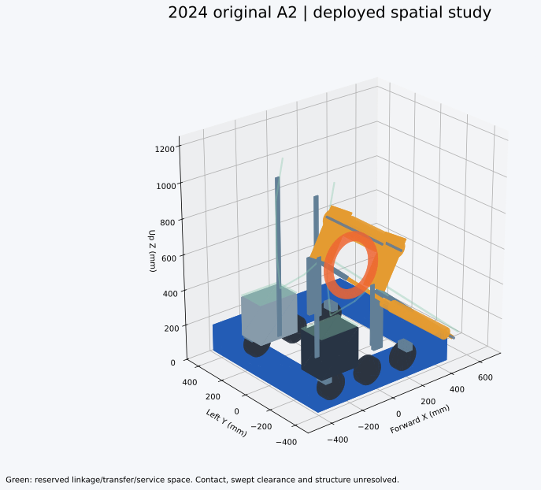

# 2024 CRESCENDO: A2 robot proof of concept



**A strategy-first, runnable desktop prototype with original editable CAD.** It completes a preload-to-pickup-to-second-release cycle under explicit simulation assumptions. It is not a qualified robot design or an official scoring simulator.

## Design highlights

- Close-range Speaker cycle narrative with Amp and feeder alternatives retained: [strategy](STRATEGY.md).
- 710 mm differential chassis, continuous bumper envelopes, reversible acquisition/indexing and 60-degree opposed-wheel shooter.
- Original coordinated telescoping cradle, with shared parameter-driven CAD/runtime motion and sampled envelope checks.
- Continuous two-piece shooter state: rotor, time, work and losses persist; outgoing body energy is accounted, and disabled motors coast rather than magically stop.
- Observable mission/fault states, editable pre-vis, condition-based [pit plan](reliability/pit-plan.json), and source/runtime-bound execution receipts.

## Run the complete A2 slice

Requires existing Python 3 with NumPy, PowerShell, JDK 17 and a populated Gradle/WPILib cache. Toolchain is pinned to Gradle 8.11, GradleRIO/WPILib 2026.2.1 and JUnit 5.10.1. This models the 2024 game using the 2026 desktop toolchain, not a historical robot deployment.

```powershell
./run-a2.ps1 -JavaHome '<JDK 17 directory>' -GradleHome '<Gradle cache directory>'
```

Open `NORMAL.html` in the printed results folder. `NORMAL_9V.html` and fault replays preserve comparisons; `SUMMARY.md`, `results.json`, `native/receipt.json` and `presentation-receipt.json` expose what ran and which inputs produced it. Each invocation requires fresh output and executes actual native tests. No robot address, installation or hardware deployment is performed.

The cache must already contain the pinned public dependencies. On a newly configured development computer, set JAVA_HOME and GRADLE_USER_HOME, then run the included `shared/examples/java-2026-sim/gradlew.bat test` from that project directory with network access to populate its cache before using the offline verified runner. Dependency notices are [here](shared/examples/java-2026-sim/THIRD_PARTY.md).

## What the current run proves

The nominal 12 V and permissive 9 V cases each record one prescribed acquisition and two powered exits in about 27.3 seconds. Missing piece, jam, stale pose and strict 9 V RPM controls fault without invented completion. Actual exit states feed sampled full-NOTE aperture checks, not a prescribed launch speed. These are sampled thin-plane results, not scores or complete target clearance.

Acquisition, lift, telescope, level retention and transfer are prescribed kinematics with virtual observations. Their actuation, contact, energy and physical capture are not validated. Shooter energy accounting covers rollers/guide only. Body attitude is a fixed 60-degree hypothesis; spin, aerodynamics, roof/walls, tire slip, realistic opponents and impact durability remain unresolved. The full serialized cycle does not fit 15-second autonomous.

## Open and edit the design

- [Stowed STEP](cad/a2/stowed.step), [deployed STEP](cad/a2/deployed.step), [stowed picture](cad/a2/stowed.svg).
- [Geometry contract](cad/cycle-contract-A2.json), [original generator](cad/build_a2_layout.py), [shared kinematics](cad/a2_kinematics.py).
- 54 original solids per endpoint are exported and reopened. Green regions reserve linkage, transfer or service space; they are not engineered hardware. Narrow nominal envelope allowances are not tolerance/strength approval.
- With existing OCP 8 and Matplotlib: `python cad/build_a2_layout.py --output artifacts/my-cad`.
- The [portable editable pre-vis](tools/blockout/README.md) lives in this project. It saves/loads the plugin design artifact and exports editable OpenSCAD; it is a generic planning tool, separate from the A2 mechanism contract.

## Project ownership and retained dependencies

This repository owns the 2024 narrative, CAD, code, replay and reliability plan. The self-contained `shared/` snapshot retains cross-season regression fixtures, including CORAL/FUEL cases. Their presence does not make them 2024 mechanisms or require private repositories. `PROVENANCE.json` distinguishes the inherited base from A2 modifications and pins this project snapshot.

The old `run.ps1` remains a legacy preloaded all-season regression entry; it is not the new full-cycle runner. Earlier rejected geometry and failed lift experiments are retained as clearly labeled evidence, not silently promoted into the active model.

Before publication: Python tests, native tests, fresh receipts, public-content guard and original CAD metadata review. No private hosting configuration or third-party team/vendor CAD is included.
