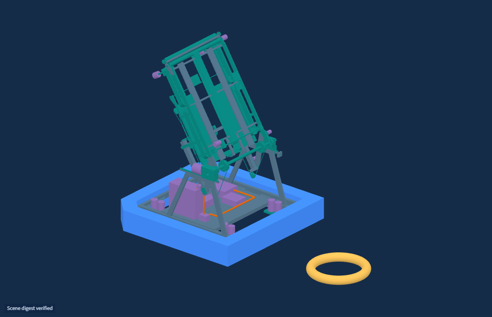

# 2024 CRESCENDO robot

<!-- cad-still -->

**Project CAD · Preliminary design of the robot · Guided cassette 1.0 · effective.** The robot is at the start of a cycle, with a floor NOTE ahead. The angled cassette picks up, retains and shoots a NOTE. The parallel guides support the climb. The still shows the layout solids of the preliminary design review in its opening pose. [Open the design review](https://ehartye.github.io/frc-2024-poc/preliminary-design/)
<!-- /cad-still -->

[Open the preliminary design](https://ehartye.github.io/frc-2024-poc/preliminary-design/) to rotate the robot, inspect a component, or play any entry in its one motion list: the checked discharge and service cases, both continuous six-NOTE scoring clocks and both climb approaches. The speaker, stage and chains are tessellated from official FIRST field CAD. The orange NOTE shows its unloaded shape during contact.

## Withdrawn rough draft

No detailed design is published. The earlier R9 robot was published before the design-status process and never passed a mechanical-readiness review, so it is withdrawn. Its published pages and models are kept in the [detailed design archive](https://ehartye.github.io/frc-2024-poc/detailed-design/). The rough draft record of its native CAD and test history left the tree with the earlier publication gates; read it with `git show ac098db:ROUGH-DRAFT.md`.
