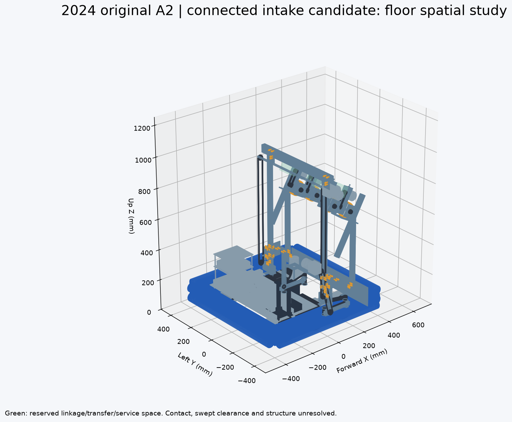

# 2024 CRESCENDO: component-based robot proof of concept



**Strategy-first editable CAD, with retained simulation experiments.** The current component assembly is a design candidate. The runnable legacy A2 cycle below uses earlier geometry and does not validate this newer robot.

## Current design highlights

- Close-range Speaker cycle narrative, with Amp and feeder alternatives retained: [strategy](STRATEGY.md).
- AM14U4-based six-wheel drivetrain with source-sized components, an original front-throat modification and fixed bumper candidate. Structural and impact qualification remain open.
- Reversible asymmetric side-pinch intake, coordinated rotation/elevator and four-wheel launcher. Original drilled lower brackets, portal gussets, carriage yokes and recessed slide-pad attachments connect previously reserved interfaces.
- 711 original/source-sized parts per exported pose. Full-NOTE intake feeding is screened at49 positions; moving mechanism clearance at125 poses. These are finite nominal geometry checks, not capture, tolerance, force or durability acceptance.
- Actual chain attachments, shaft torque/retention couplings, motor mounts and remaining shooter interfaces are still completion gates. No previous launch result automatically transfers.

## Open and edit the current candidate

- [Current original floor-pose STEP](cad/assembly/connected-floor.step), [design and limits](cad/assembly/INTAKE-CANDIDATE.md), [parameter contract](cad/assembly/intake_components.json).
- [Connected generator](cad/assembly/build_connected_candidate.py), [source-bound evidence](cad/assembly/evidence/connected-report.json), [render provenance](cad/assembly/connected-visual.json).
- With existing OCP8 and Matplotlib: `python cad/assembly/build_connected_candidate.py`. This produces floor, rotated and handoff STEP files, renders and exact-file verification receipts in `artifacts/connected-intake-candidate/`.
- Vendor native CAD is not distributed. Original authored stock/fasteners and source-sized purchased-component envelopes are distinguished in the part manifest.

## Current modeled simulation integration

The [integrated plant work](sim/integrated/README.md) now couples a force-driven four-CIM drivetrain with two intake motors and a loose NOTE on one electrical bus. Chassis movement comes from motor/tire forces, and NOTE contact reacts back onto the robot. This is **not yet a complete drivable robot simulator**: lift/launcher phase coupling, physical parameter validation and several mechanical interfaces remain open.

With the existing Python/OCP dependencies, run a fresh bounded experiment:

```text
python sim/integrated/run_coupled_acquisition.py --output artifacts/my-coupled-run.json
```

The current open-loop experiment intentionally stops at its supported geometry boundary rather than inventing capture. [Observed braking controls](sim/integrated/README.md#threshold-braking-is-a-retained-negative-control) preserve overrun and stale-observation cases. Recorded mechanism experiments, numerical refinement and unresolved conditions are included for reproducibility; they are not scoring or hardware acceptance.

## New bounded checkpoint continuation

The [eight-motor phase pilot](sim/integrated/coupled_lift_README.md) continues the exact recorded indexed state for 10 ms with four drivetrain motors, two intake motors, one lift motor and one pitch motor on one bus. It preserves momentum, time and cumulative energy, and replaces the prior 45 kg robot hypothesis with 38 kg base plus 7 kg moving mechanism rather than adding that mass twice.

```text
python sim/integrated/run_regulated_acquisition.py --index --output artifacts/my-index.json
python sim/integrated/coupled_lift_run.py artifacts/my-lift-pilot.json
```

For one fresh, strictly registered chain, run `python sim/integrated/run_current_checkpoint_chain.py artifacts/my-fresh-chain`. It executes acquisition first and refuses continuation unless that complete fresh receipt matches the registered checkpoint bytes; it then executes the pilot and verifies state/energy continuity. A mismatched state requires new registration, not a snap to the old state. The final `chain.json` binds both newly produced outputs and is absent if a stage fails.

These are separate reproducible commands: the pilot validates and uses the committed indexed checkpoint, not the output path of the preceding command. A single continuous mission runner is still unfinished. With finite gravity-feedforward commands the cradle sags slightly and the free NOTE drops; it is not attached or successfully lifted. The retained coast control stops on an unsupported tiny-negative-pitch guide-domain boundary, not a confirmed collision. Contact stiffness, mechanism mass/inertia and current normal-force budgets are explicit hypotheses. This pilot does not adopt the new spring-cassette candidate or transfer historical launcher results.

The separate [finite-command envelope study](sim/integrated/coupled_lift_sweep_README.md) extends seven predeclared cases to 25 ms using a reviewed separation-only guide gate. It preserves unsupported contact boundaries and shows the cradle and NOTE moving independently, not successful retention. The one-command chain above intentionally retains its original 10 ms pilot.

## Run the retained legacy A2 slice

Requires existing Python 3 with NumPy, PowerShell, JDK 17 and a populated Gradle/WPILib cache. Toolchain is pinned to Gradle 8.11, GradleRIO/WPILib 2026.2.1 and JUnit 5.10.1. This models the 2024 game using the 2026 desktop toolchain, not a historical robot deployment.

```powershell
./run-a2.ps1 -JavaHome '<JDK 17 directory>' -GradleHome '<Gradle cache directory>'
```

Open `NORMAL.html` in the printed results folder. `NORMAL_9V.html` and fault replays preserve comparisons; `SUMMARY.md`, `results.json`, `native/receipt.json` and `presentation-receipt.json` expose what ran and which inputs produced it. Each invocation requires fresh output and executes actual native tests. No robot address, installation or hardware deployment is performed.

The cache must already contain the pinned public dependencies. On a newly configured development computer, set JAVA_HOME and GRADLE_USER_HOME, then run the included `shared/examples/java-2026-sim/gradlew.bat test` from that project directory with network access to populate its cache before using the offline verified runner. Dependency notices are [here](shared/examples/java-2026-sim/THIRD_PARTY.md).

## What the legacy run proves

The nominal 12 V and permissive 9 V cases each record one prescribed acquisition and two powered exits in about 27.3 seconds. Missing piece, jam, stale pose and strict 9 V RPM controls fault without invented completion. Actual exit states feed sampled full-NOTE aperture checks, not a prescribed launch speed. These are sampled thin-plane results, not scores or complete target clearance.

Acquisition, lift, telescope, level retention and transfer are prescribed kinematics with virtual observations. Their actuation, contact, energy and physical capture are not validated. Shooter energy accounting covers rollers/guide only. Body attitude is a fixed 60-degree hypothesis; spin, aerodynamics, roof/walls, tire slip, realistic opponents and impact durability remain unresolved. The full serialized cycle does not fit 15-second autonomous.

## Retained earlier CAD and planning tools

- [Stowed STEP](cad/a2/stowed.step), [deployed STEP](cad/a2/deployed.step), [stowed picture](cad/a2/stowed.svg).
- [Geometry contract](cad/cycle-contract-A2.json), [original generator](cad/build_a2_layout.py), [shared kinematics](cad/a2_kinematics.py).
- 54 original solids per endpoint are exported and reopened. Green regions reserve linkage, transfer or service space; they are not engineered hardware. Narrow nominal envelope allowances are not tolerance/strength approval.
- With existing OCP 8 and Matplotlib: `python cad/build_a2_layout.py --output artifacts/my-cad`.
- The [portable editable pre-vis](tools/blockout/README.md) lives in this project. It saves/loads the plugin design artifact and exports editable OpenSCAD; it is a generic planning tool, separate from the A2 mechanism contract.

## Project ownership and retained dependencies

This repository owns the 2024 narrative, CAD, code, replay and reliability plan. The self-contained `shared/` snapshot retains cross-season regression fixtures, including CORAL/FUEL cases. Their presence does not make them 2024 mechanisms or require private repositories. `PROVENANCE.json` distinguishes the inherited base from A2 modifications and pins this project snapshot.

The old `run.ps1` remains a legacy preloaded all-season regression entry; it is not the new full-cycle runner. Earlier rejected geometry and failed lift experiments are retained as clearly labeled evidence, not silently promoted into the active model.

Before publication: Python tests, native tests, fresh receipts, public-content guard and original CAD metadata review. No private hosting configuration or third-party team/vendor CAD is included.

Current launcher spacing and original mounting correction: [revision and remaining gates](cad/assembly/launcher-mount-revision.md). The selected49.2mm gap requires fresh force/contact simulation; old launch speeds do not transfer.

An additive [spring-biased cassette study](cad/assembly/spring-cassette-candidate.md) preserves failed layouts and sampled feed conflicts. It is not adopted by the 711-part assembly or current simulation: actual springs, opening actuator, clamps and moving mass remain unresolved.

The [100 ms extension](sim/integrated/coupled_lift_duration_README.md) records partial fixed-patch domain loss: 28 of 30 nominal witnesses remain at the rejected trials. This is not proof of full physical release or a collision. Exact accepted state and rejected trial diagnostics stay separate.
