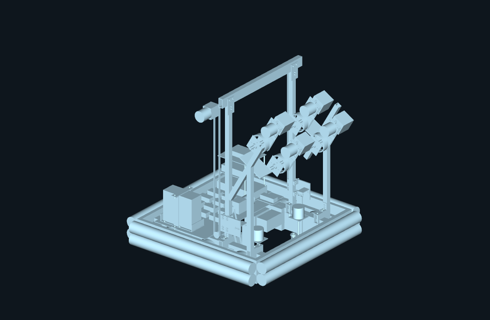

# 2024 electrical packaging candidate

<!-- cad-still -->
[](https://ehartye.github.io/frc-2024-poc/robot/cad/)

**Project CAD · Connected floor-pose assembly.** Six-wheel baseline with project-authored solids and supplier-sized envelopes. The swerve redesign is in development. [Source STEP · b08b08a8e7](../assembly/connected-floor.step) · [Rotate the model](https://ehartye.github.io/frc-2024-poc/robot/cad/)
<!-- /cad-still -->

Editable original dimensional representations, not vendor CAD and not a finished wiring or mounting design. Frame: +X forward, +Y left, +Z up; millimetres, ground origin under chassis center. Placement is a candidate for the AM14U4 integration, not verified against the complete moving assembly.


## Reproduce and integrate

With Python and the project's existing OCP environment:

```text
python cad/electrical/build_electrical.py
python cad/electrical/test_electrical.py
```

Edit `manifest.json`; `build_electrical.build()` returns `(id, native shape, role)` tuples. Default excludes service reserves; `include_service=True` includes them. Replace the four original reserve parts named in the manifest rather than stacking both representations. Generated STEP contains 143 original solids and reopens as 143 roots. No internal solid-envelope overlap was found. This does not establish chassis fit, cooling, reachability, fastener engagement or structural capacity.

## Selected components and evidence

The manifest is the source-linked BOM: one MK ES17-12 battery, Eaton CB185-120 breaker, REV PDH, NI roboRIO2, OpenMesh OM5P-AC, REV Radio Power Module, and twelve provisional SPARK MAX channels. Four channels are for four CIM drivetrain motors and require **brushed configuration**; four are shooter allocation and four are provisional auxiliary allocation. Final mechanism motor counts are not yet settled. SPARK MAX supplier documentation supports CIM operation.

The [2024 WPILib hardware overview](https://frcdocs.wpi.edu/en/2024/docs/controls-overviews/control-system-hardware.html) identifies the relevant hardware families. This is a 2024 packaging candidate, not a claim that OM5P-AC remains legal in later seasons. Full rule inspection and complete electrical schematic remain open.

roboRIO2 overall envelope was measured from the supplier's native STEP: 146.151815 x 143.179801 x 34.709443 mm. Its downloaded byte hash is pinned in the manifest. Only our resulting box is distributed. Mounting-hole locations are not yet qualified. PDH envelope follows the 2021 manufacturer drawing's protruding overall bounds, not the smaller body-only dimensions. Other representations use linked supplier dimensions. Web-page source hashes are null rather than invented.

## Mass and power limits

Known component mass is **8.3403 kg**, including the twelve allocated controllers and single battery. The current known-mass centroid is recorded in generated/verification.json. It excludes all mounts, wiring, lugs, branch protection, RSL and other omitted items. The roboRIO2 mass is now sourced as335g from the NI manufacturer specification linked in the manifest (current document, not a historical2024 revision). It is **not complete electrical mass or robot CoG**.

The PDH has twenty high-current channels; twelve are provisionally allocated. Channel count does not establish simultaneous current capacity. The 120 A breaker, motor branch protection, cable gauges, inrush, CAN termination, radio supply routing and actual load budget require a schematic and checks. The Radio Power Module provides the radio supply candidate; it is not powered directly from a guessed connector.

## Original mounts and access

Three-millimetre candidate decks and a battery tray/end stops are original editable shapes, not vendor hole-pattern claims. The selected support, battery clamp and PDH/breaker hardware are described below. Remaining device attachments and impact-rated restraint qualification are open.

Dashed volumes are editable connector/hand/lift-out/wire reservations. They are hypotheses, not connector sweep or cable bend-radius evidence. Upper electronics decks must be removable to service lower devices. Battery lift-out can conflict with other mechanisms and must be checked after full integration. Controller lead extensions, strain relief and forced-air requirements remain unresolved.

## Scope and provenance

No vendor native geometry, personal paths or private deployment links are included. Supplier model remains in ignored artifacts for private measurement. Native import was substantial (approximately 60 MB); the resulting public envelope is intentionally small. Future plugin enhancement: source-pinned native-envelope extraction, component placement/mount interfaces, partial-mass accounting and separate service-volume collision reports should be first-class operations rather than one-off scripts.

### Corrected source-flat support candidate

The retired rear drivetrain bridge is omitted. An initial rail-AABB-top mounting idea was rejected: that bounding box is not the physical top flange. The corrected candidate uses native top flanges at Z132.715 mm and actual holes at X-266.7/-139.7,Y+/-260.35 mm. Original T adapters support two aft25.4mm square tubes, crush sleeves and a common aft baseplate at Z162.115..165.115 mm. Battery elevation increased only6.554mm. No longitudinal front tubes remain.

The package includes removable deck posts, a radio-power tab, and detachable battery strap geometry. Selected shaft/head/nut stacks pass the actual rail holes; tightening, terminal placement, insulation and strength remain unverified. The strap is not approved battery restraint. Device-specific fastening to decks remains unfinished.

Native cross-package regression checks all143 electrical/support solids against84 retained drivetrain parts, replacing the two coarse rail envelopes with hash-pinned private native rails. It reports zero internal or cross-package common-volume intersections. A deliberately1mm-shifted rail bolt intersects native metal, confirming that the check can reject a misplaced fastener. Other drivetrain parts remain envelopes, not native mating geometry. The new front intake/NOTE path and full robot still require the designer's separate check.

```text
python cad/electrical/check_drivetrain.py --drivetrain <drivetrain-source-directory> --native-cache <private-native-cache> --output cad/electrical/generated/crosscheck.json
```

The cache is not distributed. Its hashes are recorded; no private filesystem paths are included. Without the native cache, the conservative rail boxes report overlaps and must not be treated as qualified mating surfaces.

## Fastening completion revision

The following revision adds selected #10-32 screws, socket/button-head geometry, hex nylon-locknut envelopes, crush sleeves and drilled attachment geometry. Threads remain nominal plain cylinders with nominal clearance in nuts, not helical contact. Standard head dimensions are from Pencom's manufacturer reference; the particular supplied screw heads have not been measured. No tightening/preload or load acceptance is claimed.

- Rail adapters: am-1047, 0.75-inch socket-head screws and am-1042 nuts.
- Tube/baseplate joints: am-1584, 1.75-inch button-head screws and am-1042 nuts. Low heads nest in baseplate access openings without touching the battery tray. Separate crush-sleeved joints anchor the baseplate.
- Battery: anchored tray and original split aluminum clamp. Two top screws release the crossbar; a 1 mm insulating pad is an explicit material/compression hypothesis. Exact terminal, lead and electrical-insulation qualification remains open. Tray and feet use am-1007, 0.625-inch screws.
- PDH: source-native four 5 mm bores, 6.35 mm ears and the asymmetric outer-envelope offset determine the mounting pattern. Four am-1056 1-inch screws pass through both decks into locknuts. The native supplier model, not a filled device box, is used for the separate hardware clearance check.
- Main breaker: deliberately changed to historical **am-0282 / CB185-120**, explicitly allowed by 2024 R609. Supplier marks this model retired; this is not a procurement-availability claim. Electrical studs are **1/4-28**, not M6. Exact native mounting is diagonal, 57.15 x 27.94 mm, and the full envelope is about 42.149 mm tall. Older generic drawing dimensions and the previous CB285 selection are recorded as differing evidence, not silently equated. An original pedestal, two am-1056 screws and nuts anchor the breaker to the baseplate.

Battery lift is checked at discrete heights after removing the top bar and disconnecting cables, not as a complete continuous robot service envelope. The native PDH/breaker test and drivetrain check bind their input files before and after execution. All vendor STEP/BREP files stay private. The public report provides hashes and measurements only.

Original solid mount volumes are assigned a **6061-T6 design material** and nominal 2700 kg/m3 density for a separate estimate. This is not measured mass, a supplier BOM mass or a strength calculation. No device envelope is assigned bulk aluminum density. Insulating material, remaining hardware and harness mass remain incomplete.

Remaining completion items include device fastening for controllers/radio/roboRIO, stack-post fasteners, exact pads and leads, whole-robot tool access, tolerance stacks, torque, structural loads and battery restraint testing. These do not invalidate the bounded nominal geometry but prevent a fabrication-ready claim.

Observed plugin enhancement needs: native feature extraction must distinguish overall bounds from actual seat planes; source model revision/mounting offsets must be preserved; head/nut stacks need cross-package checks rather than shaft-only checks; OCP `Bnd_Box.Get()` and face-cast APIs differ by installed version and require capability detection; long native checks need immutable before/after source gates and cached feature topology.

The am-1026 breaker washer was rejected after 0.0573 mm3 native interference. Direct socket-head mounting clears nominal geometry, but its 0.5334 mm radial bearing overlap is narrow and requires bearing/preload validation; this is not fastening acceptance. The top-view SVG shows component envelopes only; use STEP for the complete mount/hardware geometry.
