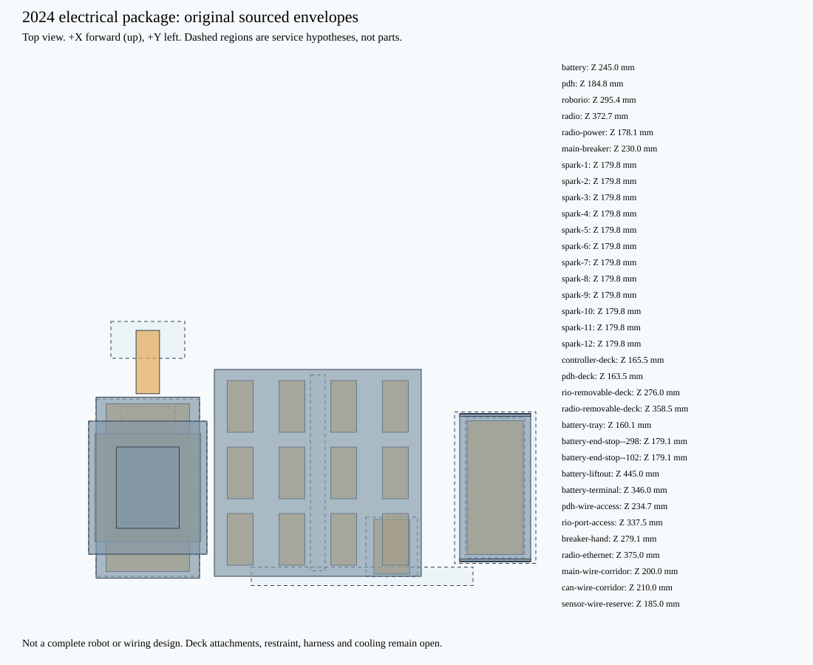

# 2024 electrical packaging candidate

Editable original dimensional representations, not vendor CAD and not a finished wiring or mounting design. Frame: +X forward, +Y left, +Z up; millimetres, ground origin under chassis center. Placement is a candidate for the AM14U4 integration, not verified against the complete moving assembly.



## Reproduce and integrate

With Python and the project's existing OCP environment:

```text
python cad/electrical/build_electrical.py
python cad/electrical/test_electrical.py
```

Edit `manifest.json`; `build_electrical.build()` returns `(id, native shape, role)` tuples. Default excludes service reserves; `include_service=True` includes them. Replace the four original reserve parts named in the manifest rather than stacking both representations. Generated STEP contains 25 original box solids and reopens as 25 roots. No internal solid-envelope overlap was found. This does not establish chassis fit, cooling, reachability, fastener engagement or structural capacity.

## Selected components and evidence

The manifest is the source-linked BOM: one MK ES17-12 battery, Eaton CB285-120 breaker, REV PDH, NI roboRIO2, OpenMesh OM5P-AC, REV Radio Power Module, and twelve provisional SPARK MAX channels. Four channels are for four CIM drivetrain motors and require **brushed configuration**; four are shooter allocation and four are provisional auxiliary allocation. Final mechanism motor counts are not yet settled. SPARK MAX supplier documentation supports CIM operation.

The [2024 WPILib hardware overview](https://frcdocs.wpi.edu/en/2024/docs/controls-overviews/control-system-hardware.html) identifies the relevant hardware families. This is a 2024 packaging candidate, not a claim that OM5P-AC remains legal in later seasons. Full rule inspection and complete electrical schematic remain open.

roboRIO2 overall envelope was measured from the supplier's native STEP: 146.151815 x 143.179801 x 34.709443 mm. Its downloaded byte hash is pinned in the manifest. Only our resulting box is distributed. Mounting-hole locations are not yet qualified. PDH envelope follows the 2021 manufacturer drawing's protruding overall bounds, not the smaller body-only dimensions. Other representations use linked supplier dimensions. Web-page source hashes are null rather than invented.

## Mass and power limits

Known component mass is **8.0053 kg**, including the twelve allocated controllers and single battery. Known-mass-only centroid is approximately (-196.82,-156.82,231.59) mm. It excludes roboRIO, all mounts, wiring, lugs, branch protection, RSL and other omitted items. It is **not complete electrical mass or robot CoG**.

The PDH has twenty high-current channels; twelve are provisionally allocated. Channel count does not establish simultaneous current capacity. The 120 A breaker, motor branch protection, cable gauges, inrush, CAN termination, radio supply routing and actual load budget require a schematic and checks. The Radio Power Module provides the radio supply candidate; it is not powered directly from a guessed connector.

## Original mounts and access

Three-millimetre candidate decks and a battery tray/end stops are original editable shapes, not vendor hole-pattern claims. Frame brackets, fasteners, standoffs, insulating provisions, battery hold-down and impact-rated restraint are not yet designed. Decks must not be treated as unsupported floating fabrication parts.

Dashed volumes are editable connector/hand/lift-out/wire reservations. They are hypotheses, not connector sweep or cable bend-radius evidence. Upper electronics decks must be removable to service lower devices. Battery lift-out can conflict with other mechanisms and must be checked after full integration. Controller lead extensions, strain relief and forced-air requirements remain unresolved.

## Scope and provenance

No vendor native geometry, personal paths or private deployment links are included. Supplier model remains in ignored artifacts for private measurement. Native import was substantial (approximately 60 MB); the resulting public envelope is intentionally small. Future plugin enhancement: source-pinned native-envelope extraction, component placement/mount interfaces, partial-mass accounting and separate service-volume collision reports should be first-class operations rather than one-off scripts.

### Integration conflict discovered before merge

The drivetrain candidate's aft bridge tube at X=-280 mm and Z160..210.8 mm crosses the controller deck/controllers and can meet the battery-side reservation. The two independently developed layouts are **not simultaneously cleared**. Whole-assembly integration must change the deck elevation/shape or bridge placement, retain actual support load paths and rerun interference checks. The exported electrical package is an editable input, not a fit certificate.
