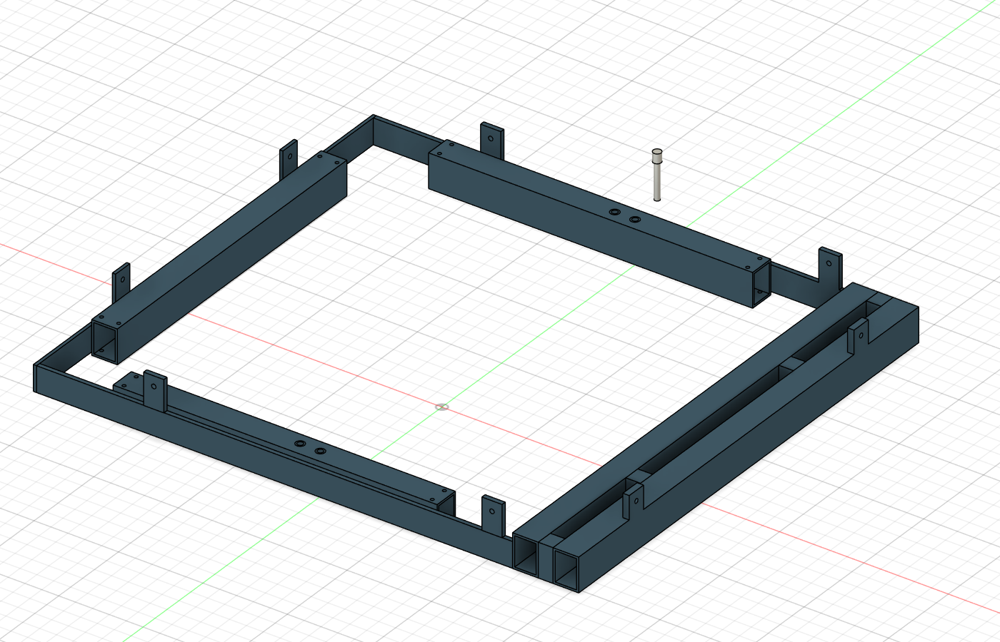

# Ground-supported frame and rail service

The ground-supported configuration retires the robot-weight mast and its removable rail fasteners. Four welded aluminum sleeves stay in the parked frame. An 8 mm stepped bench gauge lets a second person check that the original bolts have cleared their bores. Remove the gauge before moving the chassis. [Architecture decision](../../../experiments/alliance-service/study.md) · [Source assembly and mast attachment measurements](../../assembly-readiness/mast-fit.json)

The R13 Fusion archive contains 12 frame members, four retained sleeves and the loose gauge. Each frame body was checked against its parked R9 source for position, volume, material and density. Edit the gauge under **Gauge stem** and **Grip and stop**. [Download the R13 Fusion frame](../../student/r13-ground-frame.f3d) · [Native measurements and archive identity](native-fit.json)

## Identify the parts

| Item | Parked R9 | Ground-supported selection |
| --- | --- | --- |
| Side rails and four flush rail sleeves | Four 6061 aluminum sleeves, 13 mm outside diameter, 8.5 mm bore, 50.8 mm long. Two stations per rail. | Retain each welded sleeve. Leave its bore open. |
| Crossmember and upper sleeves | Upper crush sleeves belong to the mast crossmember. | Retire the crossmember with its upper sleeves and the remaining mast assembly. |
| Four fastener stacks | MISUMI CB8-100 cap screw, M8 plain washer and Accu HPN-M8-C8-Z nut at each station. | Remove and account for all four sets. |
| Inspection gauge | One project-authored, loose bench tool in 6061 aluminum. | Use only during the stationary check. |

The gauge has a nominal 8 mm diameter stem, 54 mm from tip to shoulder, and a 12 mm diameter grip, 14 mm long. Measure its actual diameter, straightness and tip condition before using it. This gauge checks for gross obstruction. Its dimensions do not establish a precision bore tolerance. [Editable gauge STEP](rail-service-gauge.step) · [Gauge and register calculations](bench.py)

## Assembly and removal

1. Identify the original parked frame and both rails. Use the frame datum to locate X = 23 and 53 mm on each Y = −329 and +329 mm rail centerline. Label the four stations before starting. The frame work assumes a stationary chassis and an independently supported, unloaded mast.
2. For a new ground-supported build, retain the four rail sleeves and omit the retired assembly. For an existing assembly, keep its weight on an independent support while accounting for the four lower nuts, washers and cap screws. Verify the complete mast and upper crossmember are clear before inspecting the rails. The lift-out path for the assembled mast and any as-built attachments requires its own shop review.
3. At each exposed station, inspect the upper and lower openings and the welded sleeve. With access to both ends, offer the gauge straight down until its shoulder reaches the top face. Its tip should project 3.2 mm below the sleeve. Binding or an obstructed underside is a failed check.
4. Withdraw the gauge on the same axis. Have the second person record the station, whether the stop seated, whether the tip was visible below, and whether the tool came back out freely. Count the four retired fastener sets and the loose gauge before closing the job.

## Measured interface and mass

The STEP reread gives a gauge volume of 4,297.70 mm³. At one nominal station, a retained original bolt occupies 2,553.49 mm³ of its insertion volume through the sleeve. With the bolt removed the seated gauge has zero interference and 0.25 mm radial clearance. A 0.40 mm lateral offset produces 36.99 mm³ of interference. The same dimensions apply at all four stations. [Offline fit receipt](bench-fit.json)

Fusion checked the complete **60 mm approach and withdrawal** at all four signed stations against the parked assembly. Before removal, the swept stem intersected the original cap screw by 4,919.43 mm³ at each station. The grip and stem also encountered the upper sleeve and nut respectively. After removal, every path cleared all 892 retained bodies at the 0.01 mm³ reporting threshold. The seated gauge had zero sleeve overlap, a projected shoulder seat of 56.35 mm² and 36.99 mm³ of sleeve overlap when shifted sideways by 0.40 mm. Two independent archive reopens reproduced the measurements. The calculation uses separate swept volumes for the grip and stem. [Four-station native results](native-fit.json) · [Fusion measurement code](../../native/ground_rail_service.py)

The selection retires 31 of the 923 parked bodies. Four welded lower sleeves contribute 41.69 g in the native material model and stay installed. The retired solids sum to 4.186 kg of native material proxies. The sourced and estimated portion of the installed mass register drops by 2.536–2.679 kg, which leaves a known installed subtotal of **41.176–44.770 kg**. Seven retired accounting entries had unknown mass. The complete robot still needs an all-up measurement. [Source-bound list of retired articles](bench-fit.json) · [R9 installed mass limits](../../assembly-readiness/mass/result.json)

Removing a transverse member changes the frame load path. The original parked hull and nominal rail fit do not establish torsional stiffness with that member absent. Retain the ground-supported configuration as a CAD service study pending a structural check and physical inspection.

## Rear corner decision

**Retain the existing square rear corners for this revision.** For a proposed 45° cut, measure the same setback along the rear and side coordinate axes. The fixed rear corner is at X = −353.6625 mm, |Y| = 355.25 mm. Each rear wheel axis is at X = −260 mm, |Y| = 260 mm. In the registered parked pose, the largest outward sum of the two horizontal offsets on the exact REV-21-3005 STEP is 96.9161 mm. Subtracting this from the old corner's two offsets (93.6625 + 95.25 mm) leaves **92.00 mm to first contact**, rounded. This is the zero-clearance intercept of an ideal plane. Any diagonal rail placed inside the plane needs additional space for its depth, fabrication tolerances and steering or service clearance. [Module revision and installation](../../drivetrain/maxswerve-layout.json) · [Measured fixed frame polygon](../../assembly-readiness/frame-fit.json)

Each rear module currently fastens to both a side rail and the rear rail. A diagonal face would need a rigid load path into that structure. Under 2024 R401 and R408–R410, its plywood and two foam layers must cover the new perimeter, with foam filling both new joints. Each end of each backing segment needs at least ½ in. of frame support within a ¼ in. gap. The square assembly has eight clear driver approaches and a verified 200 mm removal stroke. A positive cutback still needs a supported diagonal joint, impact-load review, steering and tool sweeps, and a physical check of the folded cover and removable assembly. [Rail attachment](../../drivetrain/MAXSWERVE_FRAME.md) · [Existing bumper construction and removal](../../assembly-readiness/physical-assembly.md) · [2024 FIRST Game Manual, §8.4](https://firstfrc.blob.core.windows.net/frc2024/Manual/HTML/2024GameManual.htm#R401)

## Suspended alternative

The 0.39.0 spatial check uses the earlier R8 nominal mass of 52.786 kg. At initial contact the unrotated center of mass produces residual moments of **−1.140 N·m about X and +5.231 N·m about Y**. After applying the settled orientation from the R8 disabled-hold trajectory, both residuals are below 10⁻¹⁵ N·m. This establishes static moment balance for that modeled pose. Lock and rail attachment capacity remain open. R13 removes the mast from its ground-supported configuration. [Spatial receipt](../../../experiments/alliance-service/spatial-saddle.json) · [0.38.0 elevation receipt](../../../experiments/alliance-service/elevation-results.json)
