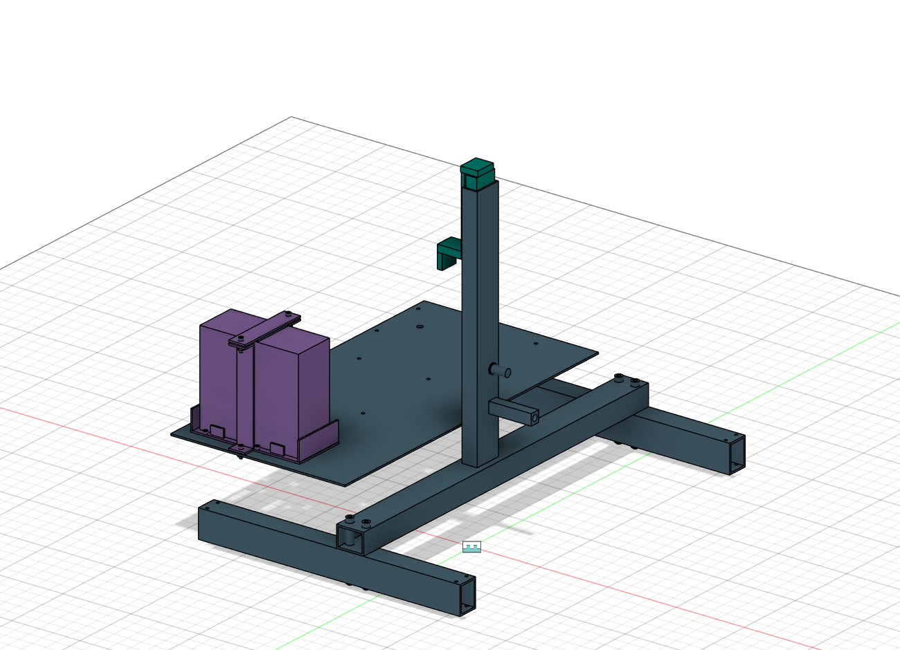
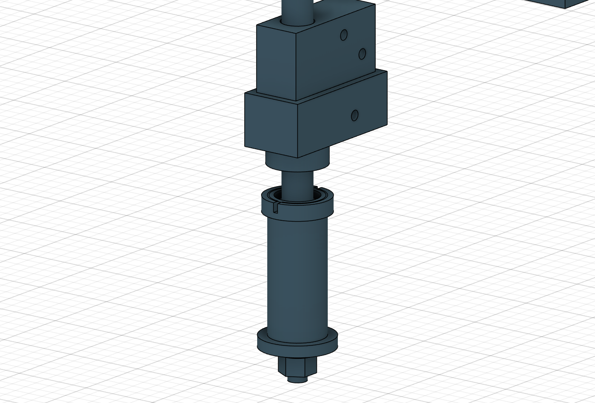

# R10 battery and mast service fixture

Open the [editable Fusion fixture](../student/r10-passive-service.f3d) to inspect the battery restraint, frame attachment, screw carrier and unloaded maintenance pin in their R9 parked coordinates. The chassis window includes the deck and two frame rails. The native timeline contains the tray changes, guide bores, beam bore and carrier recesses. The [reopen measurements](reopen.json) bind the fixture to its released R9 parent. All dimensions below are millimetres.

## Battery retention and removal

The two existing end stops are 193 apart. A replacement tray retains the original mounting pattern and adds integral locating faces 186 apart along X and 81 apart along Y. MK gives the ES17-12 dimensions as 181 × 76 × 167, with +2/−1 on each. The maximum specified case has 1.5 clearance per side when centered. The minimum has 3 per side. The rectangular battery body in this fixture is a dry dimensional gauge. Measure the actual lid and terminal guards before accepting a pad contact area. [MK case and F3 drawing](https://documents.andymark.com/cacc1eb873bfa1d6bda7b8a738560a16992dd936cd4f6e119a512326d85e2759/am-0844%20ES17-12%20User%20Guide.pdf)

At the inherited 166.878 gauge height, equal 2.125 spacer stacks under the bar leave 3.125 for a nominal 4 dielectric pad. Each stack contains a 2 spacer and a 0.125 shim. Measure the installed pad gap with the received case; adjust both stacks equally. Confirm the pad material, adhesive, permissible lid pressure and retained preload on a bench fixture. The two #10-32 × 3/4 socket screws project 4.575 below the maximum-height nuts in this configuration. [Aspen screw drawing](https://www.aspenfasteners.com/content/2D_PDF/product59/SO007-1032X34.PDF) · [Airfasco locknut table](https://airfasco.com/products/MS/MS21044.php)

For a dry service check, support the case, remove the two fasteners and loose spacer stacks, lift away the strap with its bonded pad, then raise the case vertically. The cut-out gauge uses the maximum 183 × 78 footprint continuously from the seating plane to Z1060. Both the fixture and the released R9 surroundings clear this sweep. The retained strap control intersects it by 7,020 mm³. A 2 mm shift toward each locator produces 270 or 360 mm³ of interference. Both driver approaches, both underside socket approaches and their side entries clear the fixture. Terminal insulation, flexible leads, connector withdrawal, hand clearance, dynamic restraint and a dressed case extraction require a physical receiving trial.

## Mast support and unloaded lock

The crossmember retains the four R9 frame sleeve attachments. A flanged thrust cartridge passes through both crossmember walls. A machined lower carrier replaces the bottom 27 of the moving tube. Its tenon enters the tube, and its nut flange sits below the tube in the fixed guide's 22-wide cavity. The 19.05 flange could not enter the original 15-wide moving cavity. The carrier uses two flush M4 × 16 fixings and one M4 × 14 clamp screw. The 90-degree recesses are in the near wall only. Preassemble these fasteners before sliding the tube into its guide. [Carrier screw](https://www.accu.co.uk/countersunk-socket-head-screws/5450-SSK-M4-16-A2) · [Clamp screw](https://www.accu.co.uk/metric-cap-head-screws/3995-SSCF-M4-14-A4)

The complete 380 stroke clears the stationary guide. A 2 mm lateral offset produces 17,485.77 mm³ of interference. The nominal lower and upper thrust housing seats have 103.67 and 117.62 mm² of projected support. The button-pressed pin envelope clears the extraction path. Moving the engaged detents 3 mm produces 6.80 mm³ of interference with the fixed guide. The native pairwise check found twelve positive intersections above 0.02 mm³, all at modeled mating threads.

| Article | Geometry and evidence |
| --- | --- |
| Thomson SRA3708S and BN3708S | The 9.525 major-diameter screw has a 3.175 right-hand lead. A 20-inch blank accommodates the 488.5 finished envelope and lower journal. The matching bronze nut has a 19.05 flange, a 5/8-18 external thread and a 19.05 overall length. At the 380 travel sample, the nut ends 21.95 below the screw end. [Screw](https://www.thomsonlinear.com/en/product/SRA3708S) · [Nut](https://www.thomsonlinear.com/en/product/BN3708S) |
| Two EZO F6-14M thrust bearings | Opposed 6 × 14 × 5 envelopes seat on housing bores of 8.0 and 6.8. The supplier limits the housing abutment bore to 9.2 and specifies a shaft abutment diameter of at least 10.8. Separate 12-diameter steel washers bridge the smaller shaft shoulder. Measure finish, runout, edge radius, thread relief, hardness and endplay before applying load. [Bearing dimensions](https://www.ezo-brg.co.jp/english/product/spec.php?eid=02419) |
| igus GSM-0608-08 | The 6 × 8 × 8 sleeve runs in an 8 H7 housing. The manufacturer's installed bore range is 6.020–6.068 for a 5.970–6.000 shaft. The parked gauge uses the minimum installed bore and maximum shaft. [igus sleeve bearing table](https://www.igus.com/ContentData/Products/Downloads/iglide_G300_FM_USen.pdf) |
| Accu HNN-M6-1-C8-Z | The M6 × 1 nut is 10 across flats and at most 6 thick. The journal projects 2.5 below the full nut. Confirm retention, bearing adjustment and lockring security together on the supported bench. [Nut specifications](https://www.accu.co.uk/hexagon-nylon-locking-nuts/495547-HNN-M6-1-C8-Z) |
| Ganter GN 113.4-10-30 | Both guides share a second 10 H11 bore at Z305. A 1.5 fixed-guide collar sets a 29.5 grip stack for a 30 nominal pin. Its 9.96 maximum shank passes through the bores. The projected 12 engaged-ball envelope provides a withdrawal control. Internal ball positions and button stroke require receiving inspection. [Pin dimensions](https://www.ganternorm.com/en/products/product-family/Stainless-Steel-Quality-Class-1/GN-113.4-Ball-Lock-Pins-Stainless-Steel-AISI-630-with-Finger-Recess) |

The service pose assumes external support and an unloaded stationary mast. The maintenance pin must come out before changing position. The independent original transverse lock remains at Z246. Purchased articles use original simplified envelopes. Thread tooth contact, bearing internals and the screw's actual thread-root shoulder are outside the model. Check the split clamp, tapped engagement, positive retention, shaft bending, buckling, frame loads and wear before setting a working load. The fixture has no motor or input coupling. A lifting drive selection and load qualification remain open.

## Purchased controller fit review

The R9 inventory has 16 brushless actuators and 12 controller articles. The sealed swerve modules account for four drive motors and four steer motors. Four more controllers would add 453.2 g plus 72 g for four brackets. A fifth for the unselected lifting drive would bring those additions to 566.5 g and 90 g respectively. These quantities are pending procurement. The actual mounted package reaches 81.25 end to end and 60.579 across the bracket. [Controller](https://www.revrobotics.com/rev-11-2158/) · [Bracket](https://www.revrobotics.com/rev-21-2468-pk2/) · [Bracket drawing](https://revrobotics.com/content/docs/REV-21-2151-DR.pdf)

The five candidate deck centers were tested in their proposed orientations. Stations 1, 2 and 5 break the deck edge by 1.4 at a 5-diameter hole. The brackets at stations 1 and 4 also intersect by 209.452 mm³. The five-position layout is rejected. Remaining stations still require fastener access, backing and neighbor checks. The [STEP measurements and hole coordinates](controller-mount-review.json) can be reproduced with [the comparison script](../native/controller_mount_review.py) and the exact supplier revisions identified by SHA-256. Supplier STEP files are obtained separately.

R9 remains the parked robot and retains its own mass bill. R10 is a service fixture. Its parts and candidate procurement masses have not been added to the R9 inspection weight.
