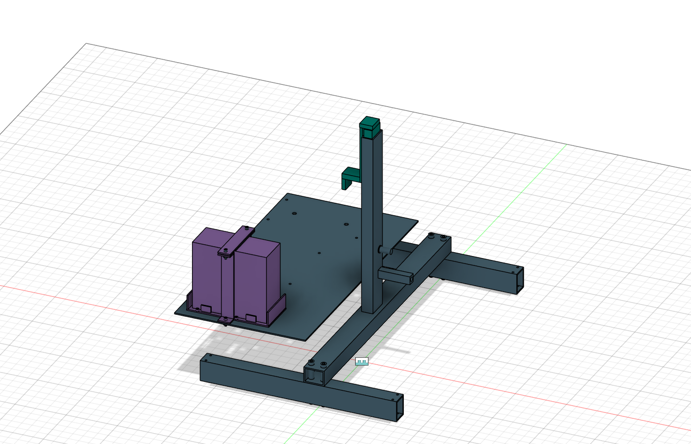

# R11 receiving plate and service tooling

The [editable Fusion study](../student/r11-service-tooling.f3d) uses the released R10 battery and mast fixture. The controller plate sits on a separate bench datum. The battery dressing volumes and parking spacer use the parked robot coordinates. The [native measurement record](r11-reopen.json) identifies both parent archives.

The image shows the parked battery case and mast. The plate drawing below shows the separate bench article. Two independent Fusion opens of the 126-body archive returned identical measurements and images.

## Four-controller bench plate

The 304 × 180 × 2 mm aluminum plate receives four REV-11-2158 controllers in REV-21-2468-PK2 brackets. Twelve M4 screws run into captive nuts on the underside. Four separate through holes attach the plate to bench tooling. The minimum distance from a clinch-hole center to the outside edge is 23.6 mm. PennEngineering requires 6.9 mm and a sheet at least 1.4 mm thick. Verify the stock hardness and press retention on a coupon before fitting the controllers. [Dimensioned drawing](bench/bench-plate.pdf) · [Editable plate exchange geometry](bench/bench-plate.step) · [PEM CLS-M4-2 datasheet](https://catalog.pemnet.com/item/nuts-types-s-ss-cls-clss-cla-sp/self-clinching-nuts-types-s-ss-cls-clss-cla-sp-metric/cls-m4-2) · [M4 × 8 screw](https://www.accu.co.uk/metric-cap-head-screws/3837-SSCF-M4-8-A2)

The private comparison seats all four purchased controllers and brackets on the plate. A separate STEP read recovered 101 solids, including all 18 supplier solids per controller. Each bracket has 490.9 mm² of nominal projected flange support, and each screw head seats on 18.85 mm² of its flange. The nearest brackets are 22.42 mm apart. The public Fusion fixture contains the original plate, fastener envelopes and removable flange-height gauges. The [comparison script](bench/private_assembly.py) reconstructs the complete assembly from the exact supplier files. [REV controller](https://www.revrobotics.com/rev-11-2158/) · [REV mounting bracket and drawing](https://www.revrobotics.com/rev-21-2468-pk2/)

| Access check | Result |
| --- | --- |
| Twelve screw shanks, twelve heads, twelve key approaches | All 36 clear. A shank displaced by 3 mm intersects the bracket by 22.79 mm³. |
| Two passive end-access gauges per controller | Each rectangular gauge extends 35 mm beyond its end. Opposing gauges leave a 4.75 mm gap. Verify the received connector, strain relief and grip against that envelope. |
| Upper end-face access | Eight additional gauges cover the full 34.5 mm case width above the barrels, from the case face outward for 41 mm. This includes both accessory-connector ends. Recess insertion and individual plug overmolds remain physical checks. [REV connector drawing](https://www.revrobotics.com/content/docs/REV-11-2158-DR.pdf) |
| Overhead air space | All four 82 × 60.6 × 25 mm volumes above the mounted packages are clear. This geometric reservation does not establish an operating temperature. |
| Incorrect controller orientation | Reversal produces 13.38 mm³ of interference with the supplier bracket. |

The [fit receipt](bench/bench-fit.json) includes every station, drill coordinate, measured clearance and supplier digest. The bench study accounts for the four additional articles in the procurement budget. Both centered deck placements failed the whole-robot fit check. With the long edge along X, the plate intersected 18 bodies, including existing controller envelopes, bolt heads and a standoff. With the long edge along Y, it intersected 20, including the power distribution and breaker supports. Vehicle fastening, vehicle service access, connector retention and thermal approval remain open.

## Mass accounting

| Item | Quantity | Basis | Mass |
| --- | ---: | --- | ---: |
| REV-11-2158 controllers | 4 | Supplier catalog | 453.20 g |
| REV-21-2151 brackets | 4 | Supplier catalog | 72.00 g |
| Accu SSCF-M4-8-A2 screws | 12 | 161 g per 100 | 19.32 g |
| Drilled plate | 1 | 108,614.614 mm³ at nominal 2.70 g/cm³ | 293.26 g |
| PEM CLS-M4-2 nuts | 12 | Upper bound from maximum external diameter and thickness at 8.10 g/cm³ | Up to 14.38 g |

The nominal mass budget for the enumerated package is **837.78–852.16 g**. The lower bound omits nut mass. Zygology lists a net weight of 0.0007 kg for CLS-M4-2. Using that distributor figure gives 8.4 g for twelve and a central estimate of **846.18 g**. Weigh a loose sample to resolve the listed precision. [Distributor part record](https://zygology.com/self-clinching-fasteners/m4-self-clinching-nut-stainless-steel-cls--m4--2) Bench attachment hardware, vehicle support, connectors and dressing are outside that range. The released R9 configuration still contains 12 controller articles for 16 brushless actuators. As a budget scenario, adding this package to the previously accounted inspection subtotal would take it from 33.898–34.984 kg to 34.735–35.836 kg before host hardware. The 136 unresolved articles still preclude a complete inspection mass. [R9 mass accounting](../assembly-readiness/mass/result.json)

## Disconnected battery dressing

Two 74 × 80 × 58 mm pockets straddle the center strap. A 24 mm wide crossover leaves the lower 13 mm clear above the case datum for the strap. The removable sill reproduces that height on the bench. The receiving gauge accepts an insulated, disconnected assembly or an inert mockup. Its dimensions are a project acceptance limit; they do not specify a cable bend radius or guarantee a particular terminal cover will fit. [MK case and terminal drawing](https://documents.andymark.com/cacc1eb873bfa1d6bda7b8a738560a16992dd936cd4f6e119a512326d85e2759/am-0844%20ES17-12%20User%20Guide.pdf)

A 49 × 38 × 17 mm receiving block rounds up the bare gray SB50 housing dimensions. It leaves 25 mm in length, 42 mm in width and 41 mm in height within one pocket. Anderson's 134G1 cover protects the unmated interface from dust. The cover, lanyard and dressed leads must fit inside the same pocket limits on receipt. [Anderson housing drawing](https://www.andersonpower.com/content/dam/app/ecommerce/product-pdfs/SB50/111923s1.pdf) · [Anderson SB50 catalog](https://cdn.powerwerx.com/productattachments/ds-sb50.pdf) · [Dust cover](https://www.andersonpower.com/product/sb50-dust-cover-red-2/)

Check the actual closed covers, capped disconnected plug and relaxed leads in the open gauge with the sill seated. Recover the separate center strap before raising the pack. The CAD test includes the union of dressing positions for the full three-millimetre case-height tolerance and sweeps the packed profile to Z1060. Record a physical removal trial with a representative pack, insulation and gloved grip. The packing gauge is detached during robot use.

The three parked dressing volumes and their three removal sweeps cleared the modeled obstacles. The detached pocket accepted all four comparison shapes. Raising a pocket gauge 1 mm produced 5,920 mm³ of interference. Lowering the crossover 1 mm produced 846.09 mm³.

## Unloaded mast parking spacer

An aluminum spacer enters along the fixed guide from the negative-Y side. Its 19.6 mm tall bearing land fits below the moving top bracket. The grasp tab stays outside the guide. A lower lip registers against its end. With the carriage independently supported, the parked gap above the spacer is 0.4 mm. The native test checks the entire 90 mm insertion and measures projected seats of 139.5 mm² below and 190.0 mm² above. The nominal sweep cleared. A 1 mm sideways shift intersected the saddle by 333.2 mm³. Confirm the actual gap, bearing-face alignment and extraction with the carriage independently supported. The component has no assigned lifting or personnel-support rating. [R10 pin, bearing and carrier study](passive-service.md)
