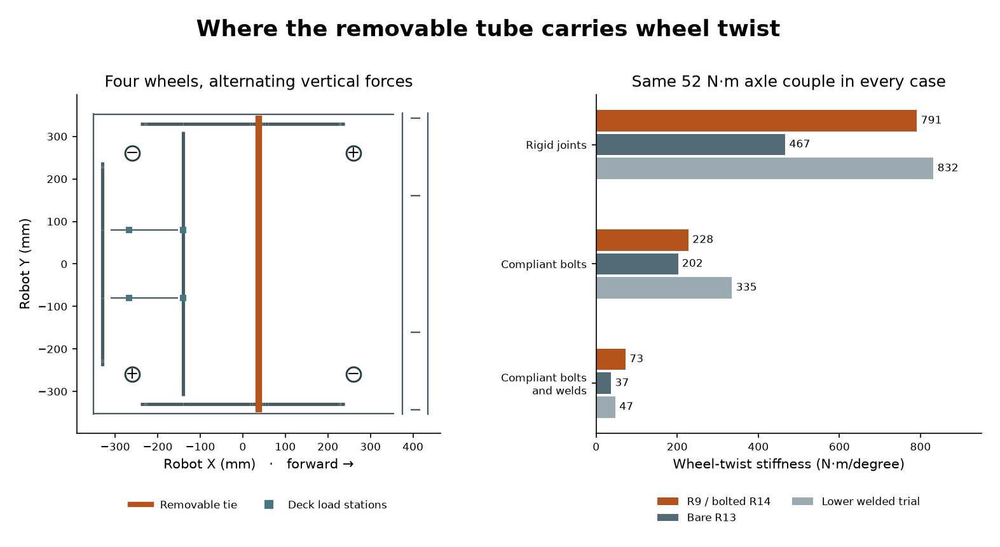

# R14 ground-supported frame stiffness

**Keep a removable transverse tube on the ground-supported chassis.** R14 retains the original four-point bolted load path at X = 38 mm and leaves the mast and its moving hardware off the robot. In a matched wheel-twist model, the bare R13 frame loses 11% to 41% of R9 stiffness with sound welds, depending on bolt-group rotation. A lower welded tube recovers that loss with rigid joints but falls below R9 when the welds are compliant. R14 is the design-review selection. Shop measurements are needed before claiming a physical stiffness or load rating.

## What changed under the same load

The four wheel-center forces alternate +100, −100, −100, +100 N on opposite corners. Each axle sees a 52 N·m couple across its 520 mm track. The front and rear couples oppose each other. Three wheel heights fix the reference plane. Their additional reactions are zero to numerical tolerance. The fourth wheel displacement gives the diagonal warp. The angle between the axles in radians is warp divided by 520 mm. These incremental forces normalize the result and assume ongoing wheel contact.

| Connection treatment | R9 with tube | Bare R13 | Lower welded trial | Bolted R14 | R13 loss from matched R9 |
| --- | ---: | ---: | ---: | ---: | ---: |
| Rigid connections | 791 | 467 | 832 | 791 | 41% |
| Firm bolts, rigid welds | 427 | 293 | 545 | 427 | 31% |
| Compliant bolts, rigid welds | 228 | 202 | 335 | 228 | 11% |
| Compliant bolts and compliant welds | 73 | 37 | 47 | 73 | 49% |

All stiffnesses are N·m/degree. Every percentage uses that row's R9 result as the denominator. All four columns use identical wheel coordinates, applied forces, material modulus and support conditions. In the rigid limit, the two bolted stations at each end share the cross-tube end rotation. R14 reproduces R9 in this model because its transverse tube and end groups are identical and no mast or upper machinery receives stiffness credit in either configuration. The lower trial uses a 38.1 × 50.8 × 3.175 mm tube centered at X = 38 mm, welded between the two drive rails. The 832-to-467 comparison uses rigid joints throughout. The 47-to-73 comparison relaxes the structural welds as well as the bolts. They answer different questions. [Full numerical results](result.json)

At the compliant-bolt setting with rigid welds, the R9/R14 diagonal warp is **2.072 mm**, versus **2.336 mm** for R13. Releasing both bolts at one end of the R14 tie gives 202 N·m/degree, within 0.1% of bare R13. Removing rotational restraint at the module groups while retaining vertical springs at the actual bolts admits a rocking mechanism. That limit has no finite static solution under the prescribed twist. The finite compliant cases are sensitivity scenarios. The real lower bound remains open until the connections are measured.

A second case supports all four wheels at equal height and applies **100 N total downward** at the four deck mounting stations. With compliant bolts and rigid welds, mean deck deflection is 0.02181 mm on R9/R14 and 0.02194 mm on R13. Reactions are 5.46 N at each front wheel and 44.54 N at each rear wheel, consistent with the aft load centroid. Deck bending and four-corner twist exercise different load paths.

## What carries load

- The load enters at the four registered wheel axes, X and Y = ±260 mm. A rigid module housing transfers vertical force and moment to its actual tab groups. Each front module attaches to one side rail. Each rear module also attaches to the rear rail. Two 10-32 fasteners per group span 25.4 mm on a 12.7 mm hole pitch. The 5.1 mm wall bores receive 4.826 mm shank envelopes and internal crush sleeves. The fit evidence gives at least 43.19 mm² of rail seat per checked interface. That contact area alone cannot determine clamp or slip stiffness. [Module registration](../../drivetrain/maxswerve-layout.json) · [Housing, rail and sleeve fit](../../drivetrain/maxswerve-supported-frame.json)
- The three drive rails use 38.1 × 50.8 × 3.175 mm aluminum tube at Z = 95.25 mm. The welded aft cross tube at X = −139.7 mm connects both side rails. Two short runners at Y = ±80 mm connect it to the rear tube. On the front, the two backing bars connect the inner nose tube to the side structure. Four spacers connect the inner and outer nose tubes. With all perimeter reinforcement credit removed, compliant-bolt stiffness is 139 N·m/degree on R9/R14 and 104 on R13. [Native member bounds and volumes](members.json) · [Reopened frame and contact survey](../../assembly-readiness/frame-fit.json)
- The upper tie spans Y = −348.4 to +348.4 mm. Its 50 × 38.35 mm section has 3 mm walls. Four Ø13.1 mm installation holes receive Ø13 mm flush sleeves with Ø8.5 mm bores. The fastener centers are X = 23 and 53 mm at Y = ±329 mm. Both end groups can transmit moment while seated and clamped. The model uses separated vertical bolt springs plus a rotational spring for the residual clamp restraint. The 0.5 mm nominal diametral shaft-to-bore clearance, unmeasured preload, friction, weld condition and bolt settling prevent a physical no-slip claim. The plain nuts still need a verified retention method. [Native sleeve and fastening geometry](../../native/physical_mount.py) · [R9 seat and tool checks](../../assembly-readiness/mast-fit.json)

The 17 restored articles bring the parked selection to **909 bodies**. They add **1.166 kg** under the native material model or **1.106–1.193 kg** in the installed mass register. The known installed subtotal becomes **42.282–45.963 kg**. A finished all-up weight remains open. The lower welded tube was a comparison only. [Selected articles and mass](result.json) · [R13 mass baseline](../ground-rails/bench-fit.json)

## Elastic assumptions and checks

The grillage solves vertical displacement and two small rotations at each node. Members use Euler–Bernoulli bending and Saint-Venant torsion. Closed-tube torsion uses the thin-wall median-area approximation. The lower portions of the backing bars use a rectangular solid section. Exact end locations are connected to member centerlines by rigid offsets. The flat wheel contact uses the registered wheel axis in plan. Vertical offsets between member centerlines do not enter this out-of-plane model. The deck and attached equipment apply external load only. In-plane racking, local wall deformation, weld stress, impact, fatigue and wheel or tire compliance require separate evidence.

The registered parts carry Fusion's Aluminum 6061 material. The model uses E = 68.3 GPa from Kaiser's typical 6061 tube data and assumes Poisson's ratio 0.33, giving G = 25.68 GPa. Lot, temper, weld procedure and heat-affected condition remain unverified. The hole bands conservatively remove the full hole width from both flanges across one diameter of member length. Local torsion is halved as a sensitivity assumption, with no sleeve reinforcement credit. Restoring the gross section changes the compliant-bolt result from 227.8 to 228.3 N·m/degree on R9/R14 and from 202.0 to 202.3 on R13. This coarse model cannot resolve stresses at the holes. [Kaiser 6061 tube data](https://online.kaiseraluminum.com/depot/PublicProductInformation/Document/1011/Kaiser_Aluminum_Soft_Alloy_Tube.pdf)

A rigid joint enforces matching vertical motion and rotations at its attachment. The firm and compliant bolt cases use 100,000 and 10,000 N/mm per vertical bolt spring, respectively, and 10⁷ and 10⁶ N·mm/rad of residual rotation stiffness per group. The weld sensitivity assigns each modeled weld connection 100,000 N/mm and 10⁶ N·mm/rad. The backing bars transfer load to the adjacent rails at two separated stations. Continuous fillets, individual bolts, thread friction and local plate flexure have no measured force–displacement law here. Absolute results depend on these assumptions. Analytic cantilever bending and eccentric-load torsion, force balance, work and a deliberately unfastened end check the implementation. [Solver](grillage.py) · [Model and load cases](study.py) · [Recorded results](result.json)

## Service and bench correlation

Use the four original M8 stacks with a separately removable bare cross-tube. A digital review should trace the top driver, bottom socket, nut, washer and screw withdrawal before moving the tube. In the R9 receipt, each station clears a Ø12 × 50 mm driver approach above the head and a Ø19 mm socket from Z = 19 to 68.25 mm below. The nominal nut engagement is 6.5 mm, with 2.75 mm of tip beyond the nut. Once the tie and all four sets are out, the selected chassis returns to R13's 892-body state, whose four 60 mm inspection paths were independently reopened. The stationary geometry envelopes exclude the operator's hand, handle sweep, actual torque and tool brand. [R9 fastening receipt](../../assembly-readiness/mast-fit.json) · [R13 four-station gauge evidence](../ground-rails/native-fit.json)

For physical correlation, reference the same four module axes on a stationary frame fixture and record the vertical displacement at all four. Use a known small reversible couple within a shop-approved fixture rating, measure frame displacement separately from stand and tire compliance, and reverse the load to expose slip or hysteresis. Record support reactions or preload to confirm contact throughout. Compare the same frame with the tie in and out, then repeat after reseating it. Use the measured diagonal displacement difference per applied couple to select or revise the model's joint range. A persistent offset after unloading, a moving witness line at a joint, or loss of support contact invalidates the linear comparison. The R14 disposition preserves the R9 load path pending that measurement.

To replay the comparison from the season checkout, run `python tests/test_frame_stiffness.py` with NumPy available. The test rebuilds the grillage and compares each result with the stored receipt. The drawing is regenerated by `python cad/service-readiness/stiffness/plot.py` with Matplotlib.
