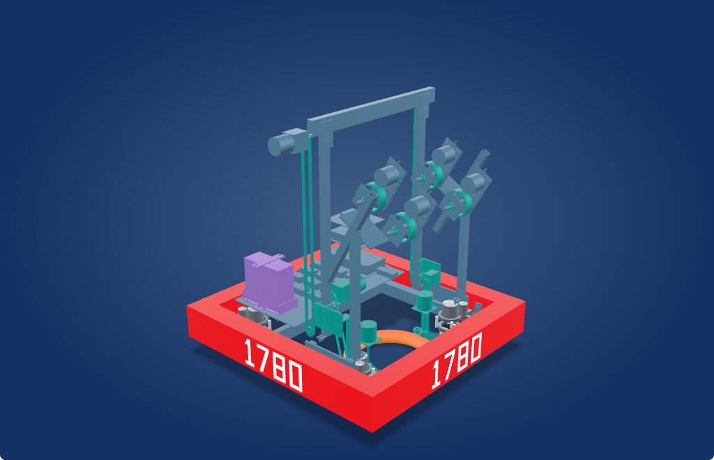

# Historical six-wheel drivetrain candidate

<!-- cad-still -->

**1780 MAXSwerve · R7.** Reopened Fusion assembly with the boxed front crossmember and red 1780 bumper. Explore the four installed swerve modules and replay the lift and first Speaker shot from development start D1. Purchased parts use dimensioned display geometry. [Inspect all four corners](https://ehartye.github.io/frc-2024-poc/?view=swerve#model). [Native model record](../media/swerve-r7.json) · [Open 3D replay](https://ehartye.github.io/frc-2024-poc/#model)
<!-- /cad-still -->

This original dimension-only assembly is a candidate for the A2 robot, not a fabrication drawing, purchased kit, or accepted drivetrain. No vendor STEP is distributed. Designer owns final placement and complete-robot integration.

## Configuration and registration

Four CIM am-0255 motors, two Toughbox Mini transmissions, six 6-inch HiGrip am-0940b wheels, four655-5M-15 belts am-2571 and eight assembled42T HTD pulleys. The center wheels use half-inch hex am-2566a_K19 output shafts and500EX hubs; four outer wheels spin on paired1614ZZ bearings and3/8-16x4.25-inch dead axle bolts. Guide pages5-7 contain the fastener/spacer/gear BOM; pages9-16 specify assembly order and bearing flange orientation. The shaft must not be replaced by a generic round axle. Central wheels drive opposite-facing front/rear pulley lanes.

The November2019 manufacturer guide proves this architecture predates2024. Current listing is discontinued; procurement availability is unresolved. It is not a claim of2024 inspection approval. Ratio is tooth-derived(50/14)*(48/16)=10.7142857, not current listing10.75. Standard square guide frame718.82x711.2mm differs from native plate envelope719.074x711.2mm; retain the difference. Both exceed the old710mm square placeholder. Center tread track579.60768mm replaces neither old600mm simulation track nor motor dynamics automatically. Axles are approximately x±222.5477mm; center drop1.778mm means the six rigid wheels are not all ground-tangent simultaneously. Tread width25.4mm; whole wheel/hub/pulley stack is wider. Outer tread stagger is preserved.

Robot frame +X forward,+Y left,+Z up, millimetres; origin at ground beneath nominal frame center. Right-handed mapping from pinned CAD is x=nativeZ-15.79782764615,y=nativeX+89.993604498469,z=nativeY+26.656576335723. It is a derived local registration, not an official field transform. Exact per-instance bounds and source occurrence paths are in candidate.json.

## Original interfaces and service

Two original25.4x50.8x3.175mm hollow crossmembers at x±280mm span y±228.6mm, bottomz160mm; four original4mm adapter plate envelopes connect toward inner rails. Alloy/grade, drilled pattern, edge distances, fastener grip, plate flexibility and load path are unresolved. They are proposed interfaces, not fastened joints. Existing frame rails must not simply be overlaid on this kit layout. Designer must reconcile intake pivots, bumper attachments and overall size.

Optional service volumes extend motor envelopes60mm inboard and outer axles120mm outboard. Those are planning assumptions requiring tool/sequence checks, not vendor certified access. Belts require wheel/axle disassembly access, frame supports must not cross belt lanes, and guide specifies inserting outer axle bolts from outside to preserve bumper-hardware compatibility. Four CIM envelopes occupy approximately x[-70.739,70.739], inner lateral endpoints±89.294,z72.366..136.374mm. Rear electrical placement cannot be declared clear without the integrated scene.

Mass evidence: four motors at manufacturer2.8lb each total5.080234544kg. All other masses remain null; this is not complete drivetrain mass. Current wheel option page mixes0.3/0.5lb without independently resolved selection; do not assign a guessed mass or use Shopify shipping weight. Controller/electrical integration is separate.

## Execute

From repository root, with existing Python/OCP:

    python tests/drivetrain/test_contract.py
    python cad/drivetrain/build_drivetrain.py --out <local-output-directory>

build(c, services=False) returns stable(id,shape,role) tuples for integration.90 original solids reopen from STEP; optional8 service reserves are separate. Most parts are simplified boxes/cylinders derived from source bounds. Bearings omit bores and race mating; housings omit internal gears; belts are envelope boxes, not modeled tooth contact. Do not interpret envelope overlaps as exact native interference or zeros as swept clearance. Original tubes are hollow. Vendor CAD remains in private cache only.

The manifest pins exact source URLs/hashes, source frame, masses/basis, instance centers and fidelity. Native import inspected260 vendor assembly leaves; selected84 functional envelopes plus6 original interface solids. No native load, drivetrain response, grip, belt tension, shaft-fit, fastener preload, electrical thermal or whole-robot acceptance. Source guide counts8 short churros, current listing12; pinned native has8. Preserve this version distinction.
