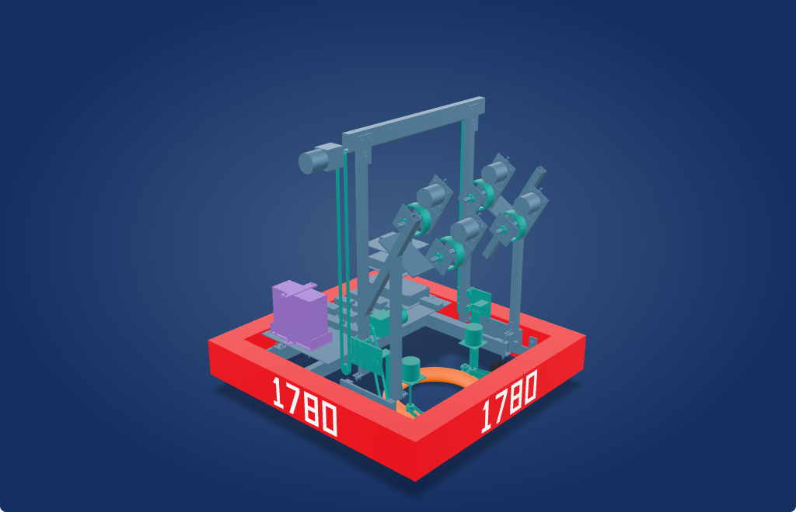

# Rejected fixed-arm lift experiment

<!-- cad-still -->

**1780 MAXSwerve · R7.** Reopened Fusion assembly with the boxed front crossmember and red 1780 bumper. The replay shows the lift, four simplified tires and first Speaker shot from development start D1. [Native model record](../../docs/media/swerve-r7.json) · [Open 3D replay](https://ehartye.github.io/frc-2024-poc/#model)
<!-- /cad-still -->

This is not part of the runnable prototype. The fixed 0.68 m arm crosses an extension envelope during its sweep even though endpoint poses appeared plausible; the design worker is revising the geometry. Its finite-torque model must not be transferred to a telescoping mechanism without radial dynamics and actuator work.

The first native trial rejected unsupported regeneration in the unchanged SharedSupply model. An explicit hypothetical shorted-motor brake avoided that rejection, but the energy-residual assertion still failed at 0.5 ms integration steps. No convergence or energy validity was established. Power-off motion was observed; zero demand did not establish retention. Preserve these controls rather than treating them as a passing lift model.

Files are archived here, outside active Java source/test directories, pending a coherent revised geometry and dynamics model. No installed actuator, braking behavior or load acceptance is implied.
