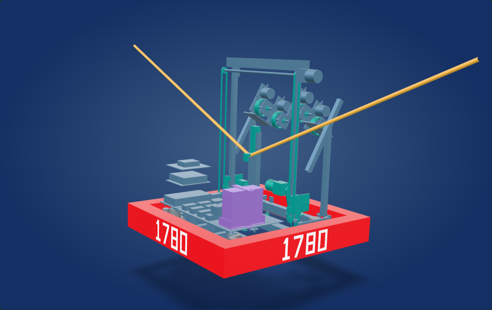

# R8 Stage climb on the R7 MAXSwerve chassis

*Nominal solo pose after the cross-pin seats. The gold curve represents the analytical chain. The viewer animates the reopened R8 assembly and its approach, load transfer and passive hold.* [Explore the poses](https://ehartye.github.io/frc-2024-poc/?view=r8-stage#model) · [Download editable R8 for Fusion](../../cad/student/r8-stage-climber.f3d)

## From a scoring lane to one chain

The straight chain leaves room for an approach with the robot's long axis perpendicular to the chain and its front facing away from the core. Start with the intake lowered. Withdraw the mechanical lock, extend the saddle outside the chain, then drive its open throat over the center. Retract until the roof bears on the chain. As it continues downward relative to the chassis, the wheels rise. At the bottom stop the return spring seats the pin through the stationary guide and inner tube. Unload the drive into that pin before the buzzer. The spring, threads and transmission are design envelopes. Choosing parts and demonstrating this sequence under load are open. [Fusion recipe](../../cad/native/stage_climber.py) · [Reopened observations](../../cad/student/r8-reopened.json)

The saddle holds one chain at a single location. The chain exits both ends along robot Y without being wound around the guide. Its 35 mm throat accepts the modeled 26.67 mm chain width. The rear lip drops 27 mm below the bearing roof. A narrow rectangular guide clears the existing upper intake shaft as the saddle travels 380 mm. A 52 mm transverse slider withdraws the lock. The frame crossmember spans the side rails with four original 8.5 mm mounting bores, shouldered fastener envelopes and crush sleeves. The first iteration placed its extended column in the shaft's swept space. The selected revision narrows and offsets the guide, shifts the beam and drills both tube walls. [Checked dimensions and poses](../../cad/student/r8-reopened.json)

## Solo load transfer

The rehearsal starts this mechanical sequence at TELEOP 125 s. The robot uses its remaining ten powered seconds, then stays under observation through the full five-second maximum. The time profile is prescribed. The ten-second service allowance in the six-robot lab begins only after its independently simulated drive reaches a target region.

| Sequence time | State | What the model checks |
| --- | --- | --- |
| 0–2.1 s | Grounded, 460 mm outside the chain | The lock withdraws, then the bearing roof rises from 480 to 860 mm. |
| 2.1–4.2 s | Align and capture | Move under the center of the chain. Lower the roof to the 717.5 mm free-chain reference. |
| 4.2–5.2 s | Transfer weight | The chain deforms toward a loaded V. Modeled floor reaction falls to zero as chain support reaches the robot's weight. |
| 5.2–7.6 s | Lift and lock | Finish retraction and engage both walls of the stationary guide. The calculated hanging attitude puts the center of mass under the roof. |
| 7.6–10 s | Settle before cutoff | Transfer static load to the pin. At 10 s the powered match ends. |
| 10–15 s | Observe the passive state | The scenario's last robot settles at +2.5 s. Check the earlier assessment and the +5 s bound. Run a second case with the pin fully withdrawn. |

The nominal 52.786 kg robot transfers 517.7 N to the chain and pin. At +2.5 s and +5 s its lowest body is 152.8 mm above the carpet. The nominal hanging tilt is 2.98°. The mass and chain-height sensitivity screen leaves 80.9 mm of floor clearance. At the nominal terminal pose, the minimum conservative gap to installed fixed Stage leaf boxes is 143.5 mm. The sampled solo chain path finds no unintended R7 or R8 body overlap across 67 poses.

The missed-pin control assumes a backdrivable screw and a 100 mm/s return under load. It reaches the carpet before assessment and earns zero modeled ONSTAGE credit. PARK requires its separate bumper-in-zone observation. In the engaged run, the floor and support witnesses pass under the stated assumptions. Referee scoring, installed actuator capability, actual lock engagement under side load, free swing and hardware proof load remain unverified. [Time series and controls](solo-trajectory.json) · [Trajectory calculation](trajectory.py)

## Load path and packaging

The robot hangs from the bearing roof, spine, top bracket, inner guide, cross-pin and outer guide. The crossmember carries the load to the two frame rails. The motor and screw carry the robot during motion. The positive pin carries it after engagement. Estimates use original solid volumes and assigned densities, bounded component envelopes, the R7 battery-and-bumper mass cases, and 0.60 kg for pads, brackets, harness and omitted drive hardware. The upper estimate varies R8 added mass by +35%. A 2× screening load approximates a design demand. It does not establish a tested working load.

The climber adds an estimated 4.771 kg. The nominal combined center is (10.6, −27.8, 281.5) mm in R7 floor coordinates. At the upper mass of 60.735 kg, static weight is 596 N. The 1.191 kN design case puts 7.58 MPa average shear on the 10 mm pin in double shear and 23.82 MPa bearing stress on the two 2.5 mm inner walls. The 658 mm simply supported crossmember screen gives 33.89 MPa bending stress. The saddle roof estimate is 29.85 MPa. These estimates exclude local hole stresses, welds, shock, fastener tension, guide binding and fatigue.

The loaded retraction peaks at 94.8 mm/s, equivalent to about 1,422 screw rpm at an assumed 4 mm lead. At 30% screw efficiency, the nominal timed motion requires approximately 164 W at the screw input. The upper static case requires 1.26 N·m there. The 2× screening load applies independently of these nominal motion assumptions. Motor, gearbox, thrust bearing and lock actuation must meet the required speed and load together.

The frame-hole envelope intersections are expected at the four fastener and sleeve stations. The reopened Fusion checks inspect eight rail walls at the hole edge and in adjacent material. The sweep includes the entire translation of each new solid against the registered lowered R7 bodies. During the sampled solo approach, the analytical chain is screened against native bounds expanded by 14 mm, except the intended saddle faces. Full intake motion, wiring, structure joints, real approach yaw tolerance, attachment strength and repeated disabled retention require further qualification. [Static calculations](static-screen.json) · [Reproduce the screen](analyze.py) · [Chain path check](chain_path.py)

## Cost of a second robot

The selected installed Blue straight chain runs along field Y at X = 226.735 in, centered at Y = 161.628 in. The Red counterpart is at (424.515, 161.622) in. The model fits a free catenary to the hanging span's measured bounds, then holds that length fixed. One central load produces two straight tension legs. Two equal loads placed symmetrically 500 mm either side produce a level middle span. The chain extrema stand in for centerline datums. The adverse floor screen lowers the loaded seat another 25 mm and combines independent R7 center-of-mass limits with R8 mass bounds. The two-robot model assumes fixed seats, common heading, equal load and coordinated engagement.

| Quantity | One robot centered | Two equal robots, ±500 mm |
| --- | ---: | ---: |
| Free chain at saddle position | 717.5 mm | 793.4 mm |
| Loaded seat height | 650.6 mm | 768.1 mm |
| Raised lip clearance after 27 mm link-height allowance | 88.5 mm | 12.6 mm |
| Lowest robot body, nominal | 152.8 mm | 270.3 mm |
| Worst-case floor clearance in the stated mass/height screen | 80.9 mm | 198.4 mm |
| Upper-case outer chain tension | 744 N | 1,189 N |

The parallel full robot envelopes have 119.1 mm between them nominally and 42.6 mm under independent adverse tilts at fixed heading. One broad-phase box implicated the R7 radio and a Stage clamp. Checking the radio box against all three actual installed Blue clamp solids gives at least 134.9 mm across the two shared poses. Unequal load, asynchronous arrival and yaw drift could consume those gaps. The middle span carries about 1,029 N in the upper case, leaving about 160 N tension difference at each saddle.

The differential tension at each shared saddle requires longitudinal retention. The design leaves the chain free to exit along Y. Dynamic seating, slip, differing partner mass and sequential acquisition remain open. The field lab assigns HARMONY only to a scenario with two independent positive hanging observations. Keeping the microphone unlit gives that pair 8 STAGE points. A HIGH NOTE on that microphone makes 10 and meets the separate two-robot ENSEMBLE threshold. The 120-second six-NOTE D1 trial uses the earlier R7, with its original mass and route. [Final rules with kickoff comparison](../../kickoff/stage-rules.json) · [Rehearsal results](../speaker-cycles/match-rehearsal.md) · [Original six-NOTE mission](../speaker-cycles/mission.md)

## Reproduction

Open the R8 archive in Fusion and drive **Lock pin withdrawal** before **Saddle extension**. Return the saddle to zero before re-engaging the lock. The mast, moving saddle and pin are independently editable components. The R7 side-rail hole pattern is an editable cut feature. The remaining R7 student components retain their prior joints. Field drawings, exact supplier assemblies and private source geometry stay with their respective owners. [R7 provenance and approximations](../../cad/native-handoff.md)

With Python and NumPy, run `analyze.py R7_PHYSICAL_SURVEY INSTALLED_FIELD_LEAF_BOUNDS`. With OpenCascade Python bindings, run `field_clamp.py FE-2024.STEP R7_PHYSICAL_SURVEY` to refine the radio/clamp broad-phase overlap. Both scripts check source identity. Run `python experiments/stage-climb/rankings.py` from the repository root to reproduce the independent qualification ledger. [Clamp distances](clamp-clearance.json) · [Qualification calculation](rankings.py) · [Official field drawings](https://firstfrc.blob.core.windows.net/frc2024/FieldAssets/2024FieldDrawings.pdf)
