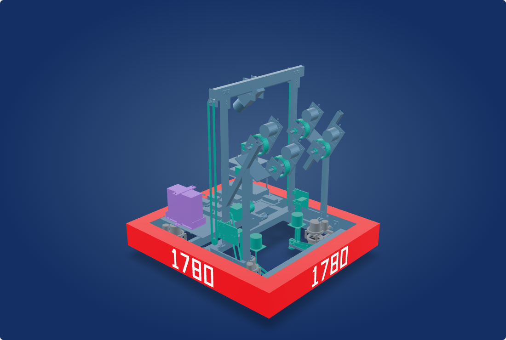

# Finite lift/pitch actuator mechanics interface

<!-- cad-still -->
[](https://ehartye.github.io/frc-2024-poc/?view=r9-assembly#model)

**1780 MAXSwerve · R9 physical assembly.** Parked robot with its inboard lift drive, frame, removable bumper and electrical supports. Purchased mechanisms use dimensioned external models. This view records mechanical fit in CAD. [Native model record](../../docs/media/r9-assembly.json) · [Inspect the parked assembly](https://ehartye.github.io/frc-2024-poc/?view=r9-assembly#model)
<!-- /cad-still -->

This standalone model exposes real generalized accelerations from finite motor torque and external loads. It does not prescribe a quintic trajectory as achieved motion, animate a completed lift mission, or prove contact persistence. Existing models and geometry are unchanged.

## Coordinates and source boundary

The designer's `cad/assembly/actuator-geometry-contract.json` is byte-bound, including its five source-module/config pins. Coordinates are `(baseX, zPivot, theta)` in meters/radians. Positive theta raises the front about robot negative Y. Cradle point `(a,b)` in the XZ plane becomes `(baseX + .178 + a*cos(theta)-b*sin(theta), zPivot+a*sin(theta)+b*cos(theta))`. zPivot is not the loose NOTE's height.

The candidate has one NEO per lift and pitch, nominal 12:1 each, and equal16T pitch-chain sprockets. Lift uses the current nominal16.4mm effective radius, not a newly validated chain velocity radius. Chain polygon effects, couplers, retention, compliance, efficiency, internal shaft inertia and hard limits remain unresolved. Positive motor directions are conventions, not wiring verification. Motor constants are pinned to a snapshot of the existing reciprocal acquisition motor law, not newly measured motor data.

## Generalized mechanics and mass ownership

Declare translating carriage mass mc, rotating mass mr, rotating local COM `(a,b)` and its COM pitch inertia I. **Exclude the loose NOTE and base chassis.** The default4kg/3kg masses,30/40mm COM offset,0.1kg m2 inertia and rotor inertias are explicit exploratory inputs, not a completed mass/COM ledger. A caller must replace the prior45kg whole-robot mass hypothesis with a coherent chassis-plus-mechanism partition before coupling; adding these7kg to it would double count.

Let M=mc+mr, x=a*cos(theta)-b*sin(theta), h=a*sin(theta)+b*cos(theta), gL=liftRatio/radius and gP=pitchRatio. The symmetric mass matrix is:

```text
[M,       0,                 -mr*h]
[0,       M + Jlift*gL^2,      mr*x]
[-mr*h,   mr*x,       I+mr*(a^2+b^2)+Jpitch*gP^2]
```

`terms(q, qd)` exposes that matrix and RHS bias `[mr*x*thetaDot^2, mr*h*thetaDot^2-M*g, -mr*g*x]`. `generalized(...)` adds motor generalized force `[0, gL*tauLift, gP*tauPitch]` and caller contact loads. The caller adds actual base-chassis mass and tire forces, solves the combined system, and reconciles mechanism/contact work. Motor rotor inertia is reflected once, not integrated as duplicate energy. Other moving/spinning components are lumped hypotheses; internal rotor gyroscopic effects are not modeled.

For external world force at pivot-relative lever `(rx,rz)`, generalized load is `(Fx,Fz,rx*Fz-rz*Fx)` plus any applied couple. Summing all contact loads uses their own physical origins. Do not use NOTE-center contact levers as pivot levers. Reported external work is `Q dot qDot`. Potential is `M*g*zPivot + mr*g*h`; kinetic energy is `0.5*qDot^T*massMatrix*qDot`. Fixed horizontal stage offset does not change these energies.

## Standalone API and explicit test boundary

`ActuatorMechanics(config, initial)` requires explicit time, full q and qd. `electrical` and `generalized` are pure. `power_port_fixed` captures a snapshot and returns a pure candidate-voltage query whose midpoint electrical power is identical to `step_fixed`. Signed regeneration is exposed; coast is open circuit and brake is a hypothetical dissipative mode. Current-limited terminal voltages outside the bus range reject the step without mutation.

`preview_fixed`/`step_fixed` **explicitly constrain baseX**, rejecting nonzero base velocity rather than silently resetting it. The required horizontal constraint reaction is reported. Its work is zero only because these fixtures truly hold baseX fixed. This is not continuation of the indexed acquisition endpoint. Moving-base integration must use the full generalized terms, not this convenience fixed-base port/step. The coordinator owns the combined chassis/body/guide solver and global supply.

Explicit midpoint integration evaluates finite motor torque and coupled mass/gravity terms. No equilibrium is forced and no angle/height is clamped. Without geometry/endstop modeling, the caller must stop outside its supported domain.

## Run and observations

```sh
python -m unittest discover -s sim/actuation -p test_mechanics.py -v
python sim/actuation/run.py artifacts/fresh-actuation-evidence.json
```

The runner requires fresh output and binds geometry/model sources before and after. Its six50ms fixtures use an externally supplied12V, not a hidden battery or completed multi-port integration. Full moving-base work identity, positive mass matrix, signs, reflected energy, query purity, controller-domain rejection and fixed-base refusal are tested.

The small positive duties in the powered fixture do not overcome its declared gravity/load: z decreases0.1743mm and pitch decreases0.00284rad. That result is retained, not tuned into a successful lift. Powered peak energy residual refines from0.440microjoule at1ms to0.108 at0.5ms and0.0267 at0.25ms. Brake fixture residual reaches0.147mJ. Energy accounting and refinement do not calibrate the masses/transmission or establish an achieved mechanism trajectory.
