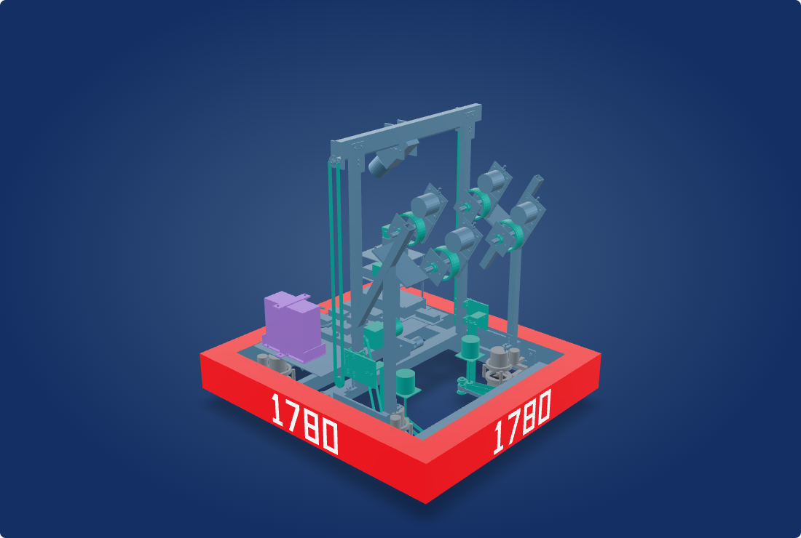

# Stateful four-CIM drivetrain experiment

<!-- cad-still -->
[](https://ehartye.github.io/frc-2024-poc/?view=r9-assembly#model)

**1780 MAXSwerve · R9 physical assembly.** Parked robot with its inboard lift drive, frame, removable bumper and electrical supports. Purchased mechanisms use dimensioned external models. This view records mechanical fit in CAD. [Native model record](../../docs/media/r9-assembly.json) · [Inspect the parked assembly](https://ehartye.github.io/frc-2024-poc/?view=r9-assembly#model)
<!-- /cad-still -->

This is a force-driven planar plant, not a kinematic driving preview or a complete robot simulation. Source-sized six-wheel contact stations, rigid gearing, wheel/rotor momentum, longitudinal slip, lateral scrub and chassis momentum persist across steps. No field collision, acquisition success, scoring, or physical validation is claimed.

## Run

From the repository root with Python 3.13 (standard library only):

```sh
python -m unittest discover -s tests -p test_drivetrain_plant.py -v
python sim/drivetrain/run.py --output artifacts/fresh-drive-evidence.json
```

The output must not exist. The runner hashes its exact dependency inventory before and after execution and atomically writes fresh evidence. A typical matrix takes several minutes because each shared-supply solve scans 512 candidate voltages; this is not yet a real-time solver. `evidence.json` is a recorded run, not a substitute for execution.

## Integration contract

`DrivePlant(config)` starts at rest. State units are SI: world XY position/velocity, positive counterclockwise heading/yaw rate, left/right wheel angular velocity and angle, elapsed seconds. Robot +X is forward and +Y is left. Two CIM motors drive each side; actual six source wheel XY stations are retained.

1. Create `power_port(dt, demands, normal_loads, modes=..., external_force_world=..., external_yaw_torque=...)` for this state and interval.
2. Pass that pure snapshot callable together with other mechanism ports to `solve_supply`. Queries do not mutate state or energy. Its electrical output is evaluated at the same predicted midpoint used for the actual mechanical step.
3. Check the solver and port domain flags, then call `step` with the identical parameters and the solved bus voltage. Never independently solve a stiff battery inside this plant.
4. Repeat for the next state. Do not reuse an old snapshot port after stepping.

Demands are signed fractions in [-1,1]; mode is explicit per side: `drive`, open-circuit `coast`, or hypothetical dissipative `brake`. A zero demand in drive is not coast. Current limiting changes actual terminal voltage; unsupported demanded terminal voltage outside the bus range is flagged and stepping is rejected without mutation. Signed regeneration is retained. The shared solver rejects net battery charging unless its separately declared ideal-absorption hypothesis is enabled.

`normal_loads` supplies aggregate left/right normal force, distributed across three stations by configurable fractions. These fractions are a hypothesis, not a solution of center-drop contact or load transfer. External world force and yaw torque are optional; `externalWork` records their work independently for future mechanism-reaction reconciliation. Wheel-side inertia includes reflected motor inertia exactly once. Rotor speed follows rigid gearing, not another duplicated inertia state.

Electrical output includes four signed motor currents, actual terminal voltage (null for an open circuit), back EMF, electromagnetic torque, bus power, winding heat and controller-brake heat. Mechanical energy includes chassis translation/yaw and wheel/rotor kinetic energy. The residual accounts for terminal/external work, winding, braking, motor/gear drag and tire-slip losses. Continued motion after disable is modeled behavior, not by itself mission failure or a safety verdict.

## Sources and hypotheses

Geometry is byte-bound to `cad/drivetrain/candidate.json`: four CIM motors, 10.7142857 ratio, 579.60768 mm center track, nominal 152.4000002 mm wheel diameter. The source 1.778 mm center drop is not enough to determine normal load distribution.

The [manufacturer-hosted CIM curve](https://files.andymark.com/CIM-motor-curve-am-0255.pdf), dated 2011-11-10, prints Kt=Ke=0.018803 SI and R=0.091 ohm. The reciprocal ideal DC law uses those values. Its printed 5310 RPM / 2.5 A no-load and 2.420395 Nm / 131.227 A stall endpoints are not all mutually reproduced. A named viscous-drag hypothesis K*2.5/(5310*2*pi/60) predicts 5964.54 RPM at 12 V, rather than hiding that discrepancy. PDF byte hash and facts are in config; no vendor PDF or CAD is redistributed here.

Mass 45 kg (30/60 kg sensitivity), yaw inertia 6 kg m², rotor/wheel inertia, tire coefficient 0.8, slip regularization, gear drag, 40 A ideal phase-current limit and braking behavior are explicit engineering inputs, not measured hardware characteristics or a completed mass estimate. The first coupled port is a 1.5-ohm synthetic electrical load, not an acquisition mechanism. The brownout case injects a source-voltage change, then applies the existing supervisory power policy to the previous observed bus; it is not battery chemistry or a guarantee of any motor controller's behavior.

## Pilot observations and limits

The 0.3-second shared-load pilot reached x=0.218381 m and v=1.237529 m/s, with minimum bus 10.5793 V. Halving dt from 1 to 0.5 ms changed x by 1.77 micrometers and v by 0.502 micrometers/s; peak global energy residual fell from 1.348 to 0.323 millijoules. These are bounded numerical checks, not calibration or convergence of arbitrary future scenarios. Center-only normal load increased modeled spin rate from 2.365 to 3.459 rad/s versus the distributed-load hypothesis. Mass, load sharing and tire assumptions remain important.

Next integration needs actual mechanism electrical ports and matching chassis reaction forces, source-consistent mass/inertia refinement, domain-aware field contact, and performance profiling before interactive use. The UI experiment is not part of this plant.
