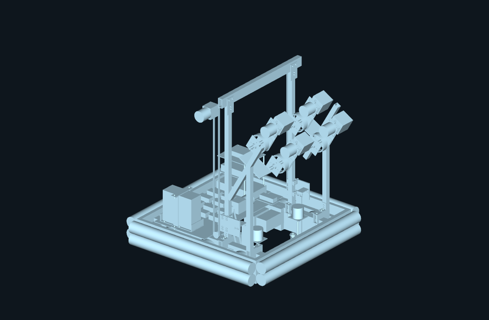

# Finite-patch motor holding interface

<!-- cad-still -->
[](https://ehartye.github.io/frc-2024-poc/robot/cad/)

**Project CAD · Connected floor-pose assembly.** Six-wheel baseline with project-authored solids and supplier-sized envelopes. The swerve redesign is in development. [Source STEP · b08b08a8e7](../../cad/assembly/connected-floor.step) · [Rotate the model](https://ehartye.github.io/frc-2024-poc/robot/cad/)
<!-- /cad-still -->

This is a small two-motor/contact subsystem, not a complete lift simulation, physical capture result or selected preload. Existing acquisition, retention and supply models are unchanged.

## Actual indexed endpoint

`evidence.json` recomputes acquisition forces at the actual final state of the source-bound indexed checkpoint, following the end-state timing rule. Archived `final.contacts` are midpoint records, not the force at final rotor/body velocity. At the current normal budget of 1.755213327 N per side and mu=0.6, even optimistic total tangential capacity is only **2.106256 N**, below the NOTE weight **2.304563 N**. No motor torque or numerical solver can fix that insufficient force budget. This necessary condition remains a negative control, not a universal declaration that continued motion is unsafe.

Acquisition positive rotor velocity drives the belt rearward (-robotX). This subsystem's positive rotor drives along +belt axis `(cos(theta), sin(theta))` in world XZ. At flat handoff, negate both rotor velocity and command; rotor kinetic energy is unchanged. Side indices remain motor0/motor1, not reordered by sign. Source time and nonzero rotor state are preserved in the mapping. No body pose/velocity is reset or advanced by that mapping.

The acquisition model has no elastic shear history. Therefore **no elastic handoff is claimed**. The memoryless mode introduces no elastic state. Finite patch registration, transverse motion/pitch-frame registration and actual guide/contact persistence still need the designer's contract.

## API

`FiniteMotorPatch(config, initial)` requires explicit time, frame angle and two rotor angular velocities. `law='memoryless-tanh'` forbids shear state. `law='elastic-plastic'` requires an explicitly supplied world shear vector at every patch.

`query(dt, bus, duties, modes, frame_angle, body_velocities, cradle_velocities, lever_world, valid)` is pure. Inputs are finite world XZ vectors per patch; `lever_world` is from NOTE center to contact and yields body pitch moment. The caller supplies midpoint body/cradle point velocities for this interval. The positive belt-axis frame is fixed for each interval; this subsystem does not integrate the lift actuator or its frame trajectory. All witness validity flags must be explicit booleans and true, otherwise it reports unknown finite-patch persistence without advancing state. Flags are an interface gate, not self-generated geometry evidence.

`power_port(...)` snapshots the current state and input vectors and returns a pure `busV -> query` callable suitable for the unchanged shared supply. Rebuild it each interval. After solving the bus, call `step` with the same parameters; it recomputes the query and commits only if controller voltage is supported. No private battery is hidden here. Return values include per-motor signed current/terminal voltage/power, per-patch force, body force and pitch moment, next rotor state and the complete energy ledger. Contact reaction on each rotor is `-radius*sum(force dot belt_axis)` for its patches; the opposite forces act on the cradle and their work is reported separately. A separate chassis/cradle origin is needed to assemble its wrench, not the NOTE-center lever.

## Constitutive choices and energy

Memoryless mode uses one **shared two-component friction-circle budget per side**, split equally among its fixed patches. The force direction follows material-minus-body slip, and magnitude is `mu*N*tanh(speed/.01)`. At zero transverse slip this is the acquisition tangential law with the explicit axis/sign conversion. It permits creep and gives zero static force at zero slip; it is not an ideal latch. Rotor dynamics use an implicit midpoint balance with reciprocal Kt=Ke, ideal current limits and finite inertia. Signed regeneration is exposed; coast is open circuit, brake is an explicitly hypothetical dissipative mode.

Elastic mode is a separately initialized elastic/perfectly-plastic shear hypothesis. History vectors rotate objectively with the supplied frame. Return mapping consumes finite friction capacity. Its nonnegative numerical return-map loss is reported **separately** from slip and electrical heat, not misidentified as a material measurement. The common ledger key `plasticHeat` denotes dissipated slip work in memoryless mode and return-map plastic work in elastic mode; it does not claim physical permanent deformation.

The ledger balances terminal work plus prescribed cradle work, minus work delivered to the body, winding/brake losses, slip heat and return-map numerical loss, against rotor and shear energy. The caller must reconcile body/cradle work with its own dynamics; those are not internally simulated masses. Finite patch points are a fixed quadrature hypothesis and are not a new pressure calibration. Normal budget, friction, stiffness and motor/current-limit parameters remain explicit model assumptions. The old10N/side or infinite `lockedBelts` assumptions are not adopted.

## Verification

```sh
python -m unittest discover -s tests -p test_finite_holding.py -v
python sim/holding/run.py artifacts/fresh-holding-evidence.json
```

The fresh-output runner binds checkpoint/model sources before and after. Tests cover actual sign conversion, the insufficient weight budget, memoryless traction equivalence, objective history, finite rotor backdrive, shared supply purity, signed regeneration, current-limit and contact-domain rejection, energy accounting and timestep sensitivity. Six synthetic20ms cases prescribe point velocities and explicitly initialized states; they are not relabeled acquisition continuation. Their near-roundoff energy closure does not establish correct physical trajectories. Memoryless final rotor speed changes from 8.19252 to 8.19015 to 8.18956 rad/s as dt halves; elastic changes from 9.00458 to 9.03352 to 9.05013 rad/s and remains more timestep-sensitive. Actual finite guide/body response, pitch/lift actuator work and continued contact are separate next gates.
