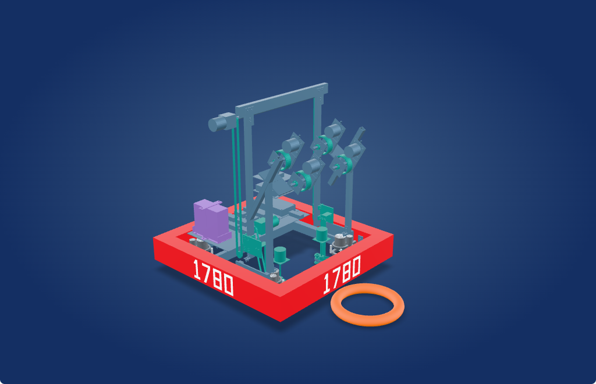

# Headless 2024 Maple arena integration

<!-- cad-still -->
[](https://ehartye.github.io/frc-2024-poc/#model)

**1780 MAXSwerve · R7.** Reopened Fusion assembly with the boxed front crossmember and red 1780 bumper. Explore the four installed swerve modules and follow the first D1 NOTE from the floor through lift and release to both modeled Speaker sensors. Purchased parts use dimensioned display geometry. [Inspect all four corners](https://ehartye.github.io/frc-2024-poc/?view=swerve#model). [Native model record](../../docs/media/swerve-r7.json) · [Open 3D replay](https://ehartye.github.io/frc-2024-poc/#model)
<!-- /cad-still -->

This module runs the actual upstream `Arena2024Crescendo`, pinned to
`1b1e8ea7278de01d40a5ea14dffbaaf13381512a`, using WPILib 2026.2.1 runtime APIs.
The game world is 2024; this is not official full-field CAD or a scoring-qualified simulator.
Upstream remains external and MIT licensed; see `licenses/MapleSim-MIT.md`.

## Run

After the separately authorized bootstrap has installed project-local Temurin
17.0.21+9 and Gradle 8.14.3, provide a clean checkout of the exact Maple commit:

```powershell
.\sim\maple\run.ps1 -MapleSource <path-to-pinned-maple-checkout>
```

The launcher never installs tools or changes global settings. Dependency resolution
uses the project-local `.gradle-home`; declared dependencies are GradleRIO/WPILib,
dyn4j 5.0.2 and JUnit 5.11.4 plus their transitive dependencies. One JUnit test
executes six scenarios: free drive, real arena wall, stage post, shared NOTE
identity/pushing, fresh-world reset, and seeded original scenario replay.
The receipt hashes original source/config and all compiled upstream Java files
before and after execution; drift aborts without an accepted receipt.

## Boundaries

The original differential adapter applies forces at two side stations, never
teleports the robot during stepping. Existing drivetrain config provides the
45 kg/6 kg m2 hypotheses and four-CIM parameters; bumper dimensions are an
original envelope. Fixed 12 V, rolling-derived motor speed and limited friction
are reduced assumptions, not six-wheel slip/rotor or battery simulation.
Inherited upstream damping is 0.1 linear and angular; bumper friction is .65
and restitution .08. Side stations at x=0 do not model distributed yaw scrub.
`forceWorkJ` is sampled pre-step force-dot-velocity work, not a complete energy
ledger or conservation proof.

Shared NOTE checks conserve one actual body identity/count, not intake ownership
or capture. Reset constructs a new arena because upstream in-place reset leaves
amp state/handlers. Seed controls only our scenario generator, not upstream's
private random source. Known upstream 2024 amplification/scoring defects remain
unmodified; scores are not accepted. No GUI, driver callback, mechanism pickup,
Fusion geometry import, or calibrated full-robot dynamics is claimed.

`evidence/first-arena-headless.json` preserves the first successful six-scenario
result. `artifacts/verified-run.json` is a fresh runtime receipt, not historical
repinning. Hardware assumptions and all upstream limitations remain explicit.
