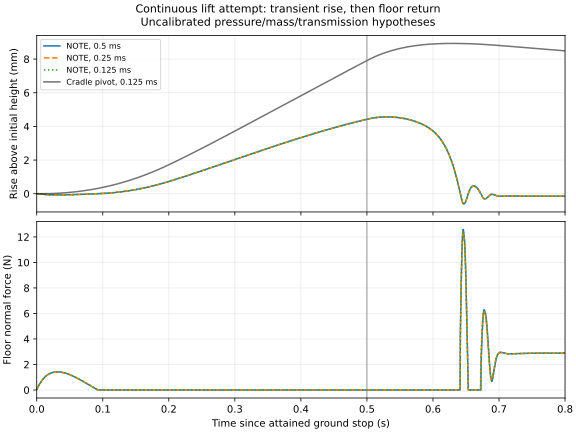

# Native pressure lift continuation

The acquired, transported and actively stopped NOTE now continues into free vertical/pitch dynamics under finite lift effort. It rises briefly and returns to the floor. Retained lift, continuous feed and shooting remain unproved. This is an uncalibrated numerical experiment with native-bound belt geometry; it is not hardware validation or a completed robot demo.



## Recorded results

All three local refinements start from the identical attained ground-stop state at 9.450 s. They preserve chassis/NOTE/rotor states, absolute clock and every inherited energy ledger entry. The new degrees of freedom begin at the old flat constraints. The mechanical join differs by only 1.25e-16 J. The 0.5 ms joined acquisition/transport/stop/lift path reaches 10.250 s, but does not retain the NOTE.

| Timestep (ms) | Maximum NOTE rise (mm) | Floor return after stop (s) | Maximum added energy residual (J) |
| --- | --- | --- | --- |
| 0.5 | 4.564550 | 0.641500 | 1.09e-05 |
| 0.25 | 4.564472 | 0.641500 | 3.72e-06 |
| 0.125 | 4.564492 | 0.641375 | 6.93e-07 |

The finest pair differs by at most 2.26263e-05 m in translation and 0.00557159 m/s in translational velocity across shared states. Declared comparison bounds are 50 micrometres and 1 mm/s. The velocity criterion fails, so the numerical prediction gate remains rejected despite matching qualitative floor-return outcomes. These are local temporal checks from one attained checkpoint, not independent full-start acquisition refinements or proof of convergence. Angular differences and all adjacent comparisons are retained in the verification receipt.

At the half-step trajectory's last sampled airborne state, the 2048-square optimistic vertical friction-cone bound is 0.588674 N against 2.304563 N weight. The 1024-to-2048 maximum contact-force difference there is 0.007145 N. This excludes static support at that particular modeled geometry even with independently optimal friction directions. It does not exclude retention at the initial geometry, where the optimistic bound is about 4.41 N, or prove hardware impossibility. A static sticking law could alter the earlier path.

Six actual states have local 512/1024/2048 pressure probes and 16/32/64 floor probes. Maximum fine pressure-force difference is 0.011867 N. Full spatial trajectory refinement and constitutive calibration remain missing. Near-flat floor quadrature agreement is a limited symmetry check, not general floor-contact validation.

## Model boundaries

`NativePressureLift` keeps the live native finite-area pressure potential and reciprocal contact work. It adds a coupled base-X/lift/pitch mass matrix, free NOTE X/Z/pitch motion and a 16-point compliant floor. Lift/pitch, pinch and drivetrain share one finite DC supply. Controls request forces through bounded motor duty; no pose, velocity or NOTE attachment is assigned. A 100 Hz integer controller tick requests an 8 mm pivot rise and hold. The XZ model rejects unsupported nonplanar states and motion outside its small experiment domain; that domain is not a native clearance certificate.

The 4 kg carriage, 3 kg rotating mechanism, COM/inertia, 12:1 transmissions and ideal reciprocal actuator model remain hypotheses from the existing actuator configuration. Seven kilograms are partitioned out of the 45 kg chassis once. Pressure density 1e7 N/m3, belt friction 0.6, ground friction 0.4, floor stiffness 20 kN/m and damping 20 Ns/m are uncalibrated. Regularized friction has no static sticking state; controller and electrical topology assumptions remain explicit.

The final 734-body native receipt provides bounds, volume and material IDs, but no numeric density, mass, COM or inertia. The candidate actuator contract leaves moving mass/COM/inertia null and installed couplings unverified. This identifies missing exported evidence, not an inability of the native CAD file to contain physical properties. Native archive identity remains unchanged. No CAD mutation, Fusion interaction or lifted whole-assembly collision check occurred in this continuation.

## Controls and preserved failures

Coasting the lift/pitch actuators causes sag and a model-domain exit at both tested timesteps. This is a control counterexample, not proof of a physical collision. Mechanical directional-work checks at entry and floor unload agree within 4.05e-8 W, the coupled mass matrix is positive definite, and an unsupported-envelope step rejects without state mutation. Source/contact/supply work checks pass on every accepted recorded step.

The initial NumPy scalar interface rejection accepted zero steps and is preserved with its executed source. The first longer runs used floating elapsed-time branches: the 0.25 ms controller began hold at 0.51 s versus 0.50 s for 0.5 ms. Those unmatched-input runs remain diagnostic. The corrected producer verifies all 80 integer-tick command events at all three levels. An initial local-probe report also collided two `receipt.json` input keys; the preserved original is superseded by a rerun with distinct semantic keys and identical numerical samples. Historical hashes are not repinned.

## Reproduction

Use the existing Python/NumPy/OCP environment. Matplotlib is needed only for the plot. First produce the attained active-stop receipt using [the native signed experiment](NATIVE_SIGNED_PRESSURE.md). Then run from the repository root with a fresh output directory:

```sh
python sim/pressure/run_native_pressure_lift_clocked.py --project . --source artifacts/native-active-stop/receipt.json --binding sim/pressure/evidence/native-signed-20261118/native-pressure-binding.json --contract sim/pressure/evidence/native-lift-20261118/native-pressure-lift-contract.json --output artifacts/native-pressure-lift-clocked-half --dt .0005 --duration .8
```

Repeat at `.00025` and `.000125` with `quarter` and `eighth` output suffixes. This is an offline experiment taking minutes, not a real-time viewer. The exact private packet contains all raw trajectories, sources, contracts and failed runs. `verify_native_lift_clocked.py` verifies that packet; the public evidence directory contains sanitized scalar receipts and a data plot, not native/vendor CAD or full state histories. `probe_native_lift_support.py` performs local support probes on an attained trajectory; `verify_native_lift_work.py` checks mechanics and atomic rejection.

The next defensible step is a separately declared, independently checked static-contact model or native mechanically supported retention, with calibrated contact properties. Native moving-body membership, installed transforms, mass/COM/inertia, actuator coupling and actual-path clearance must also be bound before promoting lift/feed. The separate staged launcher cannot be joined by teleporting this NOTE or resetting its energy.
