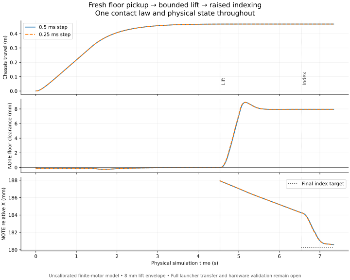

# Fresh acquisition, retained lift and raised indexing

The coarse fresh-start experiment completes a bounded floor-acquisition, 8 mm lift and 4 mm indexing request with one contact law, integrator, physical state and energy ledger. The chassis travels 0.467 m under finite motor effort. There is no NOTE pose assignment, attachment or constitutive switch at a phase boundary. This is offline, uncalibrated model evidence; full launcher transfer and hardware validation remain open.

Two independently declared numerical checks **fail**. The shared-time velocity difference is 0.00560 m/s against a 0.003 m/s bound, so timestep convergence is not established. The phase-relative diagnostic reduces the indexing difference to 3.68e-5 m/s, but acquisition still differs by 0.00417 m/s; alignment does not replace the failed original gate. The second failure is the cold-solver replay: at the coarse acquisition-to-lift transition, a cold optimizer replay differs in NOTE pitch rate by about 1.09e-6 rad/s, exceeding the original 1e-7 componentwise bound. That failure is retained. Its 2.57e-11 J energy difference and mass-metric diagnostic are consistent with the solver-gap certificates, but do not replace the failed bound. The model is not promoted to engineering acceptance.

## Recorded results

| Step (ms) | Recorded outcome | Chassis travel (m) | Final NOTE rise (mm) | Final index error (mm) |
|---:|---|---:|---:|---:|
| 0.5 | BOUNDED_CYCLE_COMPLETE | 0.467053 | 7.984959 | 0.329222 |
| 0.25 | BOUNDED_CYCLE_COMPLETE | 0.466983 | 7.985156 | 0.328244 |

The coarse sampled pickup dwell passes at 4.54 s; lift continues for 2 s and indexing for 0.8 s. Its last 0.5 s of lift has minimum whole-torus floor clearance 7.948992 mm. Minimum clearance throughout indexing is 7.951305 mm, with no floor contact. The 4 mm index request produces 3.670778 mm travel. Pinch rotors coast during lift, so longitudinal drift is visible rather than hidden by a lock.

Coarse peak absolute motor currents are 12.644 A per drive motor, 2.602 A per pinch motor and 5.127 A across lift/pitch motors. These use the existing shared finite supply and current/voltage limits. Maximum recorded cumulative energy residual is 0.0105208 J; it is reported rather than reclassified as heat.

The shared-time comparison reaches 7.330 s. Maximum translational position and velocity differences are 0.000204705 m and 0.0055998 m/s; the largest phase-event time difference is 0.01 s. The declared position/velocity/event bounds fail. Exact results are recorded in `native-static-cycle-verification.json`. Source hashes, actual imported dependencies, integer controller ticks, exact state/ledger joins, every recorded cone/gap/work bound, finite motor effort and sampled dwell/clearance gates are checked. Selected steps are reexecuted with a cold solver. The failed componentwise check remains separate from the successful phase gates and any timestep comparison. Full spatial-trajectory refinement is absent.



## What changed and what stayed fixed

`NativeStaticCycle` adds a declared floor-start corridor to the prior XZ model and starts at rest, without belt contact, at relative X = 0.657 m. Vertical and pitch dynamics, the compliant floor, live native normal-pressure potential, finite rotors and finite lift/pitch motors are active from the first step. Controller phase changes alter commands only.

The prior projected friction solver can hit its 1000-iteration cap during fresh acquisition. The exact rejected step resolves at 1070 iterations with its original tolerance. The new numerical version allows 10000 iterations and reuses the preceding optimizer impulse as an initial guess, projected onto the current disks. This cache is numerical data, not tread elasticity or physical friction memory. The physical integration body and friction iteration/acceptance body are checked unchanged. Closed-form and deliberately poor-seed controls are preserved. A separate analytical candidate failed to speed up the difficult case and was not adopted.

The initial boundary-start trial at X = 0.658 m accepts no step: a proposed endpoint exceeds the bound by about 3.3e-11 m. The separate interior start remains inside the original geometric corridor; no accepted state is corrected. The completed cold-solver prefix rejects at 1.9435 s. Two redundant cold-solver trials were cancelled for cost and are explicitly incomplete, with only reported scalar prefixes available. They are neither physical failures nor completed controls.

## Native authority and remaining transfer

The saved native F3D remains unchanged, SHA-256 `5f2a1a4cb98931f31575444e95323c9cb78bab8df6d74f226c34dc53bd62bf96`. Four native belt/tread solids bind the pressure geometry. This experiment still uses explicit 4 kg/3 kg mechanism, transmission, floor and material hypotheses; it does not substitute CAD-assigned material mass for installed mass. Native whole-assembly clearance along this attained trajectory is not established here. No Fusion interaction or uncertain audit retry occurred in this work.

From the attained coarse endpoint, the nominal intake handoff still requires 441.448 mm more rise and approximately 59.988 degrees of pitch. The historical staged launcher starts another 190.000 mm along the guide. The NOTE-only gravitational work increments are 1.017346 J and 0.379204 J; carriage/cradle work and losses are additional. This geometry/energy calculation is not a transfer simulation and does not permit splicing the staged launcher state into this run.

The next integrated experiment needs the reconciled native moving-body/transmission mapping, complete lifted/pitched hard-part screening, a qualified guide-support/drive model, and launcher contacts plus all four motor states in the same evolving state and ledger. Separate concurrent tread-shear/full-route work is not changed or claimed by this experiment.

## Reproduction

Use the existing Python/NumPy/OCP environment; Matplotlib is only needed for plots. From the repository root, choose a new output directory:

```powershell
$env:OPENBLAS_NUM_THREADS = '1'
$env:OMP_NUM_THREADS = '1'
python sim/pressure/run_native_warm_cycle.py --project . --binding sim/pressure/evidence/native-signed-20261118/native-pressure-binding.json --contract sim/pressure/evidence/native-static-cycle-20261118/native-static-warm-cycle-contract.json --output artifacts/native-static-cycle-half --dt .0005 --duration 9
```

Repeat with `--dt .00025` and another output directory. These are offline evidence runs, not a real-time viewer or GUI driving demo. The coarse run took about 19.5 minutes in the recorded concurrent session; timing is environment-dependent.

Run `verify_native_static_cycle.py` from the preserved packet directory, which contains its contracts, dependency pins and full raw trajectories, passing `--project` to the matching checkout, `--binding native-pressure-binding.json`, `--runs` with the preserved run directories, and a fresh `--output`. The public records contain sanitized comparisons, source and launch instructions; full histories, failed producers and native/vendor CAD stay private. No merge or hardware action is part of this change.
