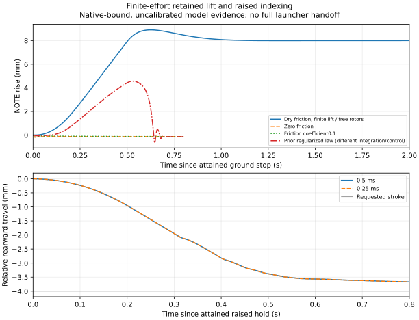

# Native-bound static lift and raised indexing

The attained NOTE now rises and remains supported under a separately declared dry-friction model with finite lift/pitch effort and free belt rotors. A subsequent finite-motor indexing request moves it rearward while raised. This is bounded, uncalibrated model progress; full launcher feed, same-law fresh acquisition and hardware acceptance remain open.



## Actual continuation

The lift starts from the exact acquired/transported/stopped state at 9.450 s. Chassis, NOTE, rotor states, absolute clock and every inherited energy ledger entry are preserved; added lift/floor loss accounts start at zero. The mechanical join differs by 1.25e-16 J. Native normal pressure geometry and potential remain active. Tangential friction, integration and the pinch policy are separately changed, so comparison with the previous drop is not an isolated one-parameter test or a same-law whole-cycle claim.

| Lift step (ms) | NOTE rise at0.8s (mm) | Maximum relative vertical drift (micrometres) | Maximum added energy residual (J) |
| --- | --- | --- | --- |
| 0.5 | 8.467402 | 1.6846 | 0.000757346 |
| 0.25 | 8.474233 | 1.7239 | 0.000379118 |
| 0.125 | 8.477659 | 1.7433 | 0.000189672 |

All three runs meet the declared retained-lift gate. The finest adjacent pair differs by at most 4.51041e-06 m and 3.5145e-05 m/s, within the predeclared50 micrometre/1 mm/s translational bounds. Angular differences remain in the receipt. This is local timestep coverage from one attained ground-stop checkpoint, not full spatial trajectory convergence.

The2s half-step run ends at 8.000042 mm rise. Its last0.5s has zero floor force, minimum rise 7.997202 mm and maximum absolute NOTE vertical speed 1.89022e-05 m/s. Peak lift/pitch current is 5.128202 A; the pinch motors coast, with finite freely moving rotor inertia. Neither the NOTE nor the rotors are locked.

Raised indexing restores that exact2s endpoint, including the controller's last contact reaction reconstructed by replaying its final step. Physical state, cumulative ledger and mechanical energy match exactly. A residual-only floating sum differs by3.55e-15 J; its initial strict diagnostic rejection and source remain preserved. The finite signed pinch controller requests a4mm rearward stroke. Actual half-step travel is 3.670452 mm, final target error 0.329548 mm and residual relative speed -0.000566157 m/s. The NOTE stays about8mm raised with no floor contact. The0.25ms continuation also passes; maximum pair position/velocity differences are 2.37926e-06 m and 3.71394e-05 m/s. Signed pinch current ranges from -0.154474 to 0.055752 A. The4mm request is a small indexing demonstration, not a verified launcher direction or handoff.

## Constitutive model and checks

Every material sample keeps its own pressure-derived normal load and isotropic Coulomb friction disk. At each step a projected convex solve finds maximum-dissipation tangential impulses coupled to base translation, lift/pitch, NOTE translation/pitch and both pinch rotors. The normal/electrical force kick precedes the friction solve; positions then advance using the resulting velocities. No NOTE pose/velocity overwrite or attachment is used. Numerical energy residual is reported; the friction projection's separate kinetic-energy removal is a diagnostic, not silently booked as physical heat.

The [Coulomb-cone formulation in the MuJoCo documentation](https://mujoco.readthedocs.io/en/stable/computation/#friction-cones) is relevant background. This additive experiment uses the existing pressure model and a NumPy impulse solver; it does not claim equivalence to the separate MuJoCo fixture or install a new engine.

Analytical sticking/sliding/zero-friction tests match closed-form answers. Partitioning one contact into100 weighted duplicates changes velocity by only1.39e-17 m/s. Independent finite differences of native contact kinematics agree within3.83e-11 m/s. The verifier checks exact sources, clock, inherited ledger, every recorded cone/gap/work bound and finite motor effort, then reexecutes selected actual steps. A tighter prescribed equilibrium study finds feasible support at friction0.32/0.4/0.6 and inadequate support at0.3 and below under the declared normal law. These are model feasibility witnesses, not measurements of material friction; the initial looser-gap study fails its unchanged stricter equilibrium residual check and remains preserved.

The8mm lift uses existing4kg/3kg moving-mass, COM/inertia and12:1 transmission hypotheses. The native734-body receipt still lacks numerical moving mass/COM/inertia and installed coupling evidence. Pressure density, friction and the compliant floor remain uncalibrated. Native archive identity is unchanged; no Fusion interaction, CAD mutation or actual lifted full-assembly clearance check occurred.

## Counterexamples and limits

Zero friction and friction0.1 cannot lift the initially grounded NOTE. Removing friction from the attained unsupported hold causes floor contact after39ms at both tested steps, showing that support is not an attachment. Impact/bounce behavior remains an uncalibrated floor-model result. Actuator coast is unresolved numerically: the original1000-iteration solve rejects after1ms; a declared10000-iteration continuation reaches an energy-gate exit at43ms with0.00201656 J added residual. Those are numerical rejections, not accepted physical collision/drop predictions.

The initial scalar-interface rejection accepts zero steps and is preserved with executed sources. No historical receipt is repinned. Current source dependencies are identical to the prior integrated checkpoint; concurrent integration into main did not alter the14 pinned numerical dependencies. Public delivery adds only this experiment and sanitized results. Native/vendor CAD and full state histories remain in the private packet.

## Reproduction

Use the existing Python/NumPy/OCP environment; Matplotlib is only for the data plot. Produce the attained active stop using [native signed acquisition](NATIVE_SIGNED_PRESSURE.md), then run from the repository root with fresh output directories:

```sh
python sim/pressure/run_native_static_lift.py --project . --source artifacts/native-active-stop/receipt.json --binding sim/pressure/evidence/native-signed-20261118/native-pressure-binding.json --base-contract sim/pressure/evidence/native-lift-20261118/native-pressure-lift-contract.json --contract sim/pressure/evidence/native-static-lift-20261118/native-static-lift-hold-contract.json --output artifacts/native-static-hold --dt .0005 --duration 2
python sim/pressure/continue_native_raised_index.py --project . --source artifacts/native-static-hold/receipt.json --binding sim/pressure/evidence/native-signed-20261118/native-pressure-binding.json --base-contract sim/pressure/evidence/native-lift-20261118/native-pressure-lift-contract.json --lift-contract sim/pressure/evidence/native-static-lift-20261118/native-static-lift-hold-contract.json --contract sim/pressure/evidence/native-static-lift-20261118/native-raised-index-contract.json --output artifacts/native-raised-index --dt .0005
```

The recorded0.8s lift matrix uses `native-static-lift-contract.json` and timesteps `.0005`, `.00025`, `.000125`; controls use `--mu 0`, `--mu .1`, or `--coast`. `verify_native_static_lift.py` and `verify_native_raised_index.py` consume the preserved packet and exact sources; the private packet includes all trajectories. These runs take minutes and are offline evidence, not a real-time robot viewer.

The next integration needs the same contact law from fresh acquisition, native moving-body/transmission binding and clearance through the actual lifted/pitched launcher path. The present small motion envelope cannot establish the full feed. No merge or hardware action is part of this change.
