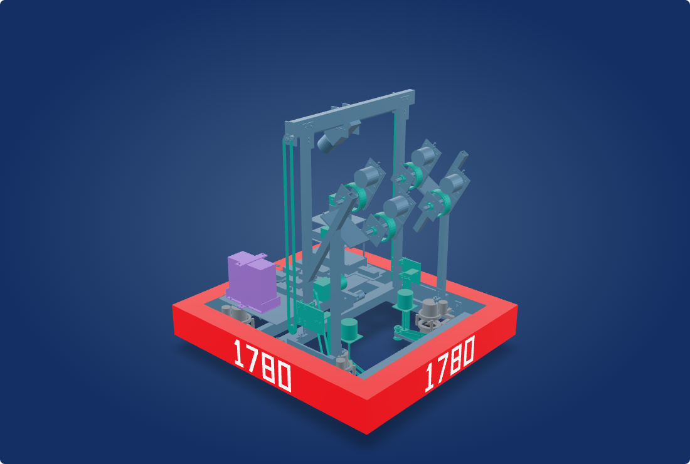

# Finite contact-patch retention requirements

<!-- cad-still -->

**1780 MAXSwerve · R9 physical assembly.** Parked robot with its inboard lift drive, frame, removable bumper and electrical supports. Purchased mechanisms use dimensioned external models. This view records mechanical fit in CAD. [Native model record](../../docs/media/r9-assembly.json) · [Inspect the parked assembly](https://ehartye.github.io/frc-2024-poc/?view=r9-assembly#model)
<!-- /cad-still -->

This is a constructive friction-wrench feasibility calculation, not a rigidly attached NOTE simulation. The source-bound requirement run uses verified nominal patch witnesses alongside synthetic negative controls; neither is a physical retention validation.

Each side's hypothesized normal load is distributed equally among its selected point witnesses. At each point, planar tangential force is bounded by mu times that normal share. A weighted minimum-norm force allocation is constructed for translation and pitch torque. A construction inside every friction circle is a conditional feasible allocation. If a necessary total force or torque bound is exceeded, that force/preload hypothesis is insufficient. If the construction fails but necessary bounds do not, the result is unresolved, NOT a proof of infeasibility. Lateral/roll/yaw imbalance is also unresolved rather than silently discarded.

Desired pitch and lift use explicitly prescribed quintic trajectories only to calculate required forces/torque. Passing a wrench screen would not prove the NOTE follows those trajectories. No pressure distribution, compliance, slip evolution, lateral recentering or physical retention is established. A collapsed point-contact control cannot transmit pitch torque; loss of one side cannot be accepted by this planar model.

## Source-bound requirement cases

Run `python sim/retention/run_requirements.py --output artifacts/a-fresh-retention-requirement-run`.

The saved28cases use30 native-authored belt-face/NOTE-interior witnesses per case (15per side), longitudinal offsets0,9.88835038313412,10,20mm and seven load/motion hypotheses. The exact9.888mm offset is checked against the recorded ground-dwell state; it is not silently reset to center. Uniform-solid-torus inertia and hypothetical10N/side,mu.6 remain assumptions, not measured parameters.

At each offset, the slower 1 s pitch plus 1.2 s lift requirement has a constructive allocation at all 441 samples. Faster 0.15 s pitch exceeds necessary bounds at 34 samples. The 0.5 s pitch case has 23 to 25 unresolved allocations, not a proof of impossibility.

The required-wrench calculation does not execute retention. Bearing flange and +/-5 mm lateral-entry checks remain separate geometry gates.

## Free planar finite-shear follow-up

`python sim/retention/finite_slip.py --output artifacts/a-fresh-finite-slip-run` integrates NOTE translation and pitch, finite elastic/plastic shear patches and optional belt-rotor backdrive. It starts from the recorded ground-dwell longitudinal position and near-zero velocity. It does not constrain the NOTE to follow the prescribed cradle. Source geometry/configuration registration and ground-state lineage are checked.

The tangential elastic history is transported with the prescribed belt material frame before slip accumulation. This corrects the earlier inertial-history surrogate in ac844d4: a prestressed zero-slip patch now co-rotates its force while preserving spring energy. The earlier pitch result is superseded, not reused.

Under the explicit locked-belt, 10 N/side, 2000 N/m-side shear hypothesis, the NOTE stays within the nominal footprint witness domain for the 2.2 s motion. Final NOTE pitch is approximately 63.33 degrees versus the cradle's 60 degrees; it is not snapped to the cradle. Coast exits the fixed footprint domain at 0.2307 s, fast pitch at 0.0166 s, and 2 N/side preload at 0.1187 s. These are model-validity boundaries, NOT verified physical drops or safety failures. Real contact could migrate.

Energy residual decreases from 0.182 mJ to 0.085 mJ to 0.043 mJ at 100/50/25 microsecond steps. This alone does not establish trajectory convergence. Ground support remains a frictionless lowest-point penalty, and contact stiffness, normal preload, friction and locked-belt actuation are uncalibrated hypotheses.

The actual free-body center, attitude and velocity need fresh transfer/contact registration before joining the downstream model. Eight regressions cover objective co-rotation, source closure, free motion, backdrive, domain exits, energy refinement and invalid inputs.

## Finer timestep diagnostics

Run `python sim/retention/refine_slip.py --output artifacts/a-fresh-refinement` and then `python sim/retention/summarize_refinement.py artifacts/a-fresh-refinement/report.json artifacts/a-fresh-summary.json`. The tracked compact summary binds the complete archived trace report by SHA-256 and all current inputs; it does not pretend to contain the complete trace.

At 25/12.5/6.25 microseconds, all three runs remain inside the nominal fixed-patch domain. Across saved, interpolated traces, the last refinement changes center by at most 0.0118 mm, pitch by 0.000192 rad, velocity by 0.00282 m/s and angular velocity by 0.0557 rad/s. These differences decrease relative to the preceding pair; angular-velocity sensitivity is still explicitly visible. Maximum energy residual falls from 0.0434 to 0.0206 to 0.0109 mJ. This is a bounded numerical diagnostic, not a continuous-time convergence proof, calibration, or downstream transfer acceptance. Between-saved-sample extrema are not bounded.

## Unsnapped CAD handoff boundary

`python sim/retention/check_free_handoff_pose.py --output artifacts/a-fresh-free-handoff` checks the actual finest-step final NOTE pose against all 711 current CAD parts. Its center is [182.980, 0, 482.877] mm, pitch about 63.36 degrees, downward velocity about 41.7 mm/s, and pitch rate about -0.0919 rad/s. None are reset to match the cradle or old aligned six-drive model.

The single-pose native screen finds only the two designated side-belt overlaps, no other represented-part contacts. This is NOT a transfer trajectory or retention guarantee; the known undersized bearing representation remains a separate source-native gate. The actual final velocity/attitude require continued dynamic contact integration before release or score claims.
